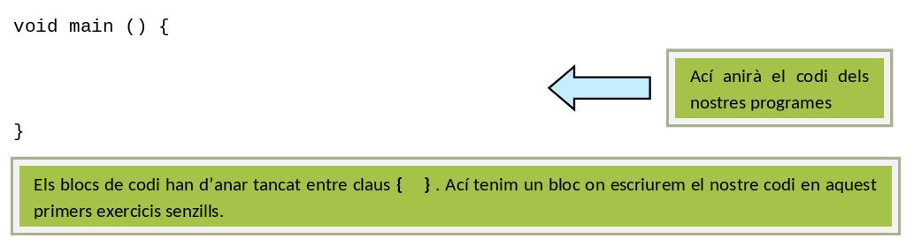
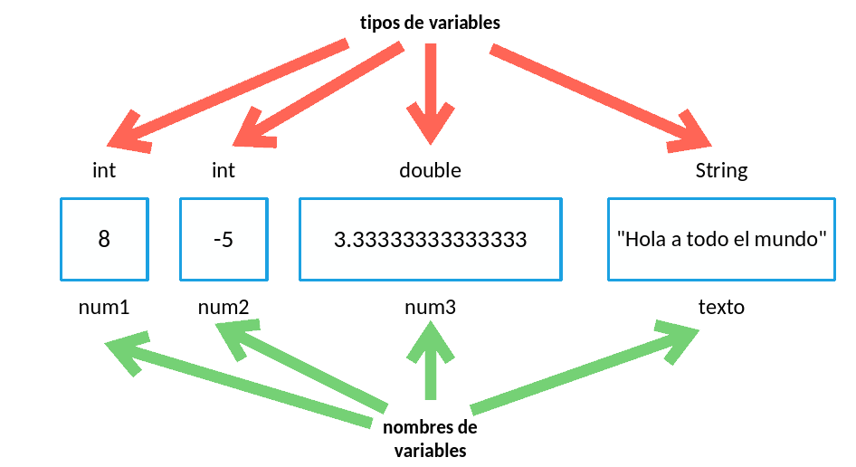
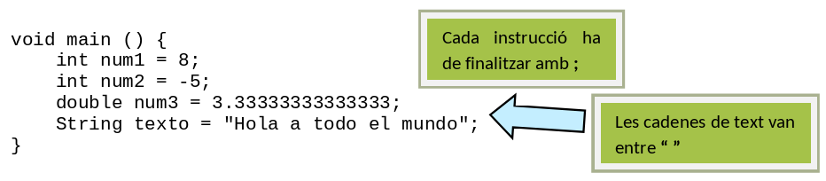
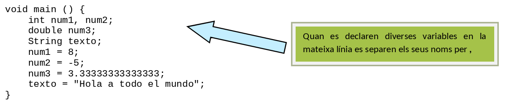
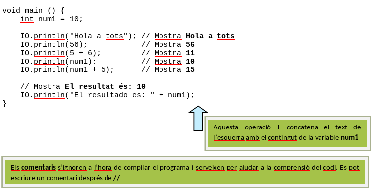
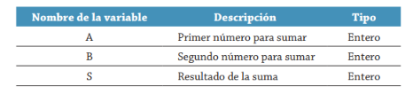
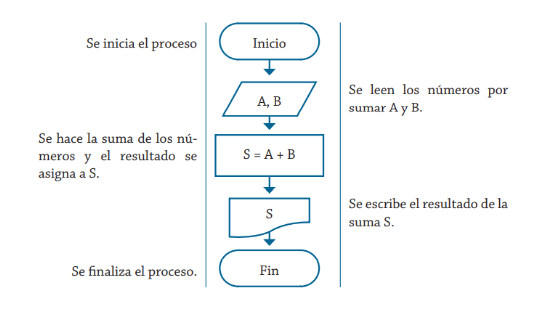
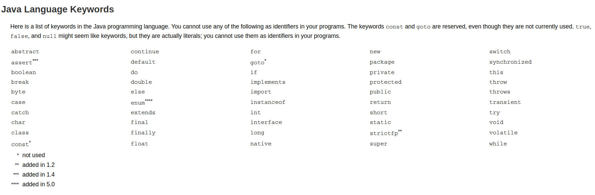

# Conceptes bàsics de programació en llenguatge Java

## Conceptes bàsics

Els programes escrits en Java que es desenvoluparan en aquestes primeres unitats començaran amb la següent estructura:

{ style="display: block; margin: auto;" }

Quan necessitem emmagatzemar una dada en la memòria de l'ordinador, i aquesta pot canviar de valor al llarg del temps, utilitzem les **variables**. Les variables poden emmagatzemar tot tipus de dades (números enters, reals, text...) En Java hem d'assignar un nom únic a cada variable que utilitzem en el nostre programa. A més d'aquest nom, s'ha d'especificar quin tipus de dades va a emmagatzemar (no ocupa ho mateix un número enter que un número real). En la **declaració** d'una variable s'especifica tant el tipus de dades com el seu nom.

!!! note "Nota"
    A partir de la versió 10 de Java es permet la utilització de l'identificador `var`, inferint el tipus de la variable. Està totalment prohïbit el seu ús en aquest moment del curs.

{ style="display: block; margin: auto;" }

Per a donar un valor a una variable s'utilitza l'operador assignació `=`. Es pot donar un valor inicial a les variables en el moment de la seua declaració. Quan es dóna aquest valor inicial a la variable es realitza la **definició** de la variable.

El següent codi mostra la declaració i definició de les variables de l'anterior gràfic.

{ style="display: block; margin: auto;" }

Aquest mateix exemple es podria haver realitzat fent la declaració i definició per separat.

{ style="display: block; margin: auto;" }

Per a mostrar missatges de pantalla es pot utilitzar el mètodes `print` i `println`. A continuació, es mostra el codi on es posa d'exemple l'ús d'aquests mètodes.

{ style="display: block; margin: auto;" }

Com hen vist als anteriors exemples, `println` pot mostrar text, números, el resultat d'una variable, la concatenació de text amb altre text (o números, expressions, valor de variables...).

L'operador assignació `=` és fonamental en programació, podem utilitzar-lo per a canviar el valor a una variable, no tan sols a l'inici del programa, a la seua definició. A continuació, es mostra el següent codi on s'exemplifica l'ús d'aquest operador.

```java
void main () {
    int num1, num2;

    num1 = 0;        // num1 val 0
    num2 = 2         // num2 val 2
    num1 = 2 + 4;    // num1 val 6
    num2 = num1 - 1; // num2 val 5
    num1 = num1 * 2; // num1 val 12
}
```

Com s'ha pogut observar les expressions a la dreta del símbol d'assignació `=` poden arribar a ser tan complexes com vulguem. Entrem detalladament a la darrera operació d'assignació.

`num1 = num1 * 2;`

Aquesta instrucció faria ho següent:

- Avalue l'expressió que hi ha a la dreta de l'operador `= (num1 * 2)`.
  - Mire el contingut de la variable `num1` (en aquest moment val 6).
  - Multiplique aquest valor per 2 (6*2 donaria un valor de 12).
- Aquest valor el emmagatzem a la variable que apareix a l'esquerra de l'operador assignació (`num1`).

A efectes pràctics hem aconseguit doblar el valor que hi havia a la variable num1.

Cada vegada que executem qualsevol dels exemples anteriors, el resultat obtingut serà sempre el mateix. Al següent exemple permetrem la interacció de l'usuari amb el nostre programa. Això es realitza mitjançant la introducció de dades al programa (mitjançant teclat en aquests primers exemples). 

El codi mostra l'ús de l'`Scanner` per a l'entrada de dades. Aquest codi implementa en llenguatge Java l'algorisme que realitza la suma de 2 números. El diagrama de flux per a aquest algorisme és el vist anteriorment:

{ style="display: block; margin: auto;" }
{ style="display: block; margin: auto;" }

El seu pseudocodi era:

1.	Inici 
2.	Llegir A, B 
3.	Realitzar S = A + B 
4.	Escriure S 
5.	Fi

Mentre que el codi Java podria ser el següent:

```java
import util.Scanner;  // 1a línia necessària per a utilitzar Scanner
void main () {
    int A, B, S;                           
   
    // Activem Scanner per a llegir des del teclat
    Scanner leer = new Scanner(System.in);  
    IO.print("Introduce el número A: ");

    // El programa espera a que s'introduisca un número enter
    A = leer.nextInt();  

    // Continuem amb el segon número
    IO.print("Introdudeix el número B: ");
    B = leer.nextInt();

    S = A + B;
    IO.println("El área del rectángulo es: " + S);
}
```

## Caracters i seqüències d'escapament en Java
En aquest apartat estudiarem els caràcters que poden aparèixer en un programa Java. Ja sabem com crear un programa bàsic, ara veurem els caràcters que podem fer servir per construir programes més complexos.

Els caràcters que poden aparèixer en un programa Java per formar les constants, les variables, les expressions, etc. són:

- Les lletres mayúscules i minúsculas de la A(a) a la Z(z) dels alfabets internacionals (la Ñ(ñ) és vàlida).
- Els dígits (0, 1, 2, …).
- Els caràcters `_`, `$` i qualsevol caràcter Unicode per damunt del `00C0`.
- Els caràcters especials i signes de puntuació seguent: `+ - * / = % # # ! ? ^ “ ‘ ~ \ | < > ( ) [ ] { } : ; . ,`
- Espais en blanc: s'anomenen espais en blanc als següents caràcters: espai, tabulador, salt de línia. La seua labor és la mateixa que la d'un espai en blanc: separar entre elements d'un programa.
  
Per exemple, podem escriure el mètode main sense utilitzar espacis en blanc, de la següent manera:

```java
void main(){IO.println("Hola Mundo!!!");}
```

Encara que queda molt més clar si introduïm espais:

```java
void main() {
    IO.println("Hola Mundo!!!");
}
``` 

- Sequències d'escapament: una seqüència d'escapament està formada per una barra inversa seguida d'una lletre o d'una combinació de dígits. Representa sempre un sols caràcter, encara que s'escriga amb dos o més caràcters. S'utilitza per a realitzar accions amb salt de línia o per usar caràcters no imprimibles. Algunas secuencias de escape definidas en Java son:

| Seqüència d'escapament | Descripció |
| ---------------------- | ---------- | 
| \n | Salt de línia. Posa el cursor al principi de la línia següent. |
| \t | Tabulador horitzontal. Mou el cursor fins endavant una distància determinada pel tabulador. |
| \" | Cometes. Permet mostrar per pantalla el caràcter cometes dobles. |
| \' | Cometa simple. Permet mostrar per pantalla el caràcter cometa simple. |
| \\ | Barra inversa. |

**Exemples d'ús de les seqüències d'escapament en Java.**

A continuació, veurem alguns exemples d'ús de les seqüències d'escapament per a poder entendre millor perquè serveixen:

**Exemple 1**: ús de la seqüència d'escapament `\n` o salt de línia. Provoca un salt al principi de la línia següent en el lloc on es coloca.

```java
IO.println("Juan\nVíctor\nAlfonso\nEnrique");
```

Eixida per pantalla:

Juan
Víctor
Alfonso
Enrique


**Exemple 2**: Ús de la seqüència d'escapament `\t`. Provoca que el cursor avance una distància determinada.

```java
IO.println("Dilluns\tDimarts\tDimecres");
```

Eixida per pantalla:

Dilluns    Dimarts    Dimecres

**Exemple 3**: Ús de les seqüències d'escapament `\"` i `\'`. Permet mostrar aquests caràcters per pantalla.

```java
IO.println("\"Dilluns\",\"Dimarts\",\'Dimecres\'");
```


Eixida per pantalla:

"Dilluns","Dimarts",'Dimecres'

## Identificadors i paraules reservades en Java

### Identificadors en Java
Els identificadors són els noms que el programador assigna a les variables, constants, classes, mètodes, paquets, etc. un programa. Les seues característiques són:

- Estan formats per lletres i dígits.
- No poden començar per un dígit.
- No poden contenir cap dels caràcters especials vists a l'apartat anterior.
- No pot ser una paraula reservada de Java. Les paraules reservades a Java són totes les que apareixen al subapartat següent.

Exemples didentificadors vàlids:
Edat nom_Preu $quantitat PreuVendaPúblic

Exemple d'identificadors no vàlids:

- 4num --> Identificador no vàlid perquè comença per un dígit
- z# --> No vàlid perquè conté el caràcter especial #
- "Edat" --> No vàlid perquè no pot contenir cometes
- Tom's --> No vàlid perquè conté el caràcter '
- any-naixement --> no vàlid perquè conté el caràcter - 
- public --> no vàlid perquè és una paraula reservada del llenguatge
- __preu:final --> no vàlid perquè conté el caràcter : 

Java diferència entre majúscules i minúscules, per tant, nom i Nom són identificadors diferents.

### Paraules reservades de Java.
Les paraules reservades són identificadors predefinits que tenen un significat per al compilador i per tant no es poden fer servir com a identificadors creats per l'usuari en els programes.

Les paraules reservades a Java ordenades alfabèticament són les següents:

{ style="display: block; margin: auto;" }


## Comentaris en Java.
Un comentari és un text que s'escriu dins un programa amb la fi de facilitzar la comprensió del mateix. Els comentaris s'utilitzen per a explicar i documentar el codi font.
En Java es poden utilitzar tres tipus de comentaris:

- Comentari tradicional estil C/C++. Comença amb els caràcteres `/*` i acaba amb `*/`. Poden ocupar més d'una línia i poden aparèixer en qualsevol lloc on puga aparèixer un espai en blanc. No poden niar-se.

Exemples de comentaris estil C/C++:

```java
/* 
    Programa Ecuació segon grau
    Calcula les solucions d'una ecuació de segon grau
*/

/* Lectura de dades per teclat */
```

Comentaris d'una línia. Comencen amb una doble barra `//`  i es poden extendre fins final de línia. No tenen caràcter de terminació.
Exemples de comentaris d'una línia:

```java
// Programa Ecuació segon grau
// Calcula les solucions d'una ecuació de segon grau
int p; // preu del producte
```


