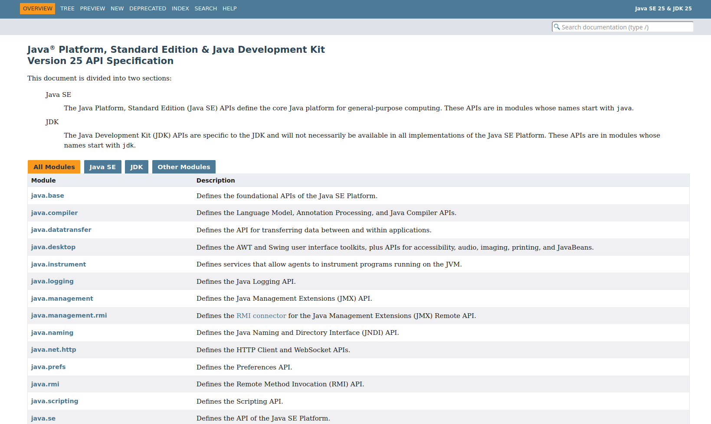

# El llenguatge de programació Java

Java és un llenguatge de programació orientat a objectes desenvolupat per Sun Microsystems a principis dels anys 90. El seu creador, James Gosling, el va batejar com a Oak.

A continuació, es mostren les versions de Java, juntament amb la seua data de llançament, actualment amb suport:

- Java SE 8 (LTS): Març de 2014. Suport especial.
- Java SE 11 (LTS): Setembre de 2018. Suport especial.
- Java SE 17 (LTS): Setembre de 2021. Suport especial.
- Java SE 21 (LTS): Setembre de 2023.
- Java SE 25 (LTS): Setembre de 2025.

## Què necessite per a programar en Java?

Necessitem:

El JDK (*Java Development Kit* o Kit de Desenvolupament en Java). És el programari que ens permet crear aplicacions Java de diferents tipus. És el primer que hem de tindre instal·lat al nostre ordinador. El JDK inclou:

- El JRE (*Java Runtime Environment*). És la màquina virtual de Java que tradueix el bytecode a codi executable.

- El compilador de Java. És l'encarregat de convertir el nostre codi font a bytecode.

- API de Java (*Application Programming Interface*). Conté tots els paquets, classes i interfícies del llenguatge Java. És el codi que proporciona Java perquè el programador desenvolupe les seues pròpies aplicacions.

L'entorn JDK funciona única i exclusivament mitjançant ordres de consola:

- **javac**: És l'ordre compiladora de Java.
    La seua sintaxi és: `javac Exemple.java`
    L'entrada d'aquesta ordre ha de ser necessàriament un fitxer que continga codi escrit en llenguatge Java i amb extensió **.java**. L'ordre ens crearà un fitxer **.class** per cada classe que continga el fitxer Java. Els fitxers .class contenen codi bytecode, el codi que és interpretat per la màquina virtual.

- **java**: És l'intèrpret de Java. Permet executar aplicacions que prèviament hagen sigut compilades i transformades en fitxers .class.
    La seua sintaxi és: `java Exemple`
    No cal ací subministrar l'extensió del fitxer, ja que sempre ha de ser un fitxer .class.

!!! tip "Execució directa de fitxers font (Java 11+)"
    Des de la versió 11, el JDK permet executar directament un fitxer font amb l'ordre: **`java Exemple.java`** *(incloent l'extensió `.java`)*. El compilador processa el codi directament en memòria RAM i l'executa sobre la marxa, **sense generar cap fitxer `.class`** al disc.

### JShell: Proves ràpides interactives (REPL)

A partir de Java 9, el JDK inclou una eina interactiva de línia d'ordres anomenada **JShell**. És el que en programació es coneix com un entorn REPL (*Read-Eval-Print Loop*).

!!! info "Què és un entorn REPL?"
    Un entorn REPL llegeix la instrucció que introduïu, l'avalua al moment i en retorna el resultat per pantalla. És l'eina ideal per a practicar la sintaxi de Java, experimentar amb operadors o provar mètodes sense haver de crear una classe ni un mètode `main`.

Per a utilitzar-lo, només cal obrir la consola o terminal i escriure l'ordre `jshell`:


```bash
$ jshell
|  Welcome to JShell -- Version 25

jshell> int a = 10;
a ==> 10

jshell> IO.println("La meitat és " + (a / 2));
La meitat és 5

jshell> /exit
|  Goodbye

```

Dins de JShell, pots escriure codi Java normal. No obstant això, l'eina té les seues pròpies ordres de control que sempre comencen per una barra inclinada (/). Per exemple, /exit s'utilitza per a tancar el programa, i /vars et mostra una llista de totes les variables que has creat durant la sessió.

## Documentació: API de Java.
A [https://docs.oracle.com/en/java/index.html](https://docs.oracle.com/en/java/index.html) es troba la documentació oficial de Java. La més interessant és la documentació de l'API de Java. El següent enllaç correspon a l'API de la Java SE (JDK 25 LTS):

[https://docs.oracle.com/en/java/javase/25/docs/api/index.html](https://docs.oracle.com/en/java/javase/25/docs/api/index.html)

{ style="display: block; margin: auto;" }


## Entorns de desenvolupament per a Java

El kit de desenvolupament bàsic proporcionat per Oracle és el mínim que es necessita per a desenvolupar un programa en Java. És útil si es necessita compilar aplicacions Java de manera esporàdica.

No obstant això, l'escriptura i compilació de programes feta d'aquesta forma és un poc incòmoda. Per això, nombroses empreses fabriquen els seus propis entorns d'edició, algunes inclouen el compilador i altres utilitzen el mateix JDK d'Oracle. Alguns avantatges que oferixen són:

- Facilitats per a escriure codi.
- Facilitats de depuració.
- Facilitat de configuració del sistema.
- Facilitats per a organitzar els arxius de codi.
- Facilitat per a exportar i importar projectes.

L'entorn de desenvolupament per a Java que utilitzarem en el mòdul serà: IntelliJ IDEA. Aquest entorn està creat per la companyia JetBrains.

{ style="display: block; margin: auto;" }