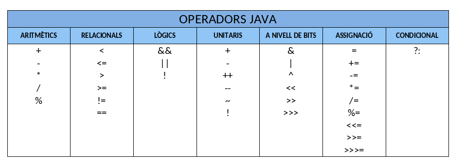
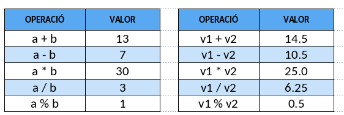
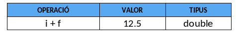
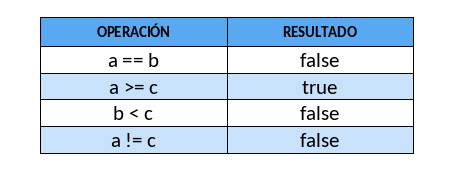
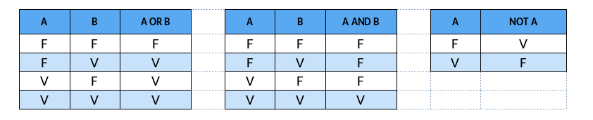
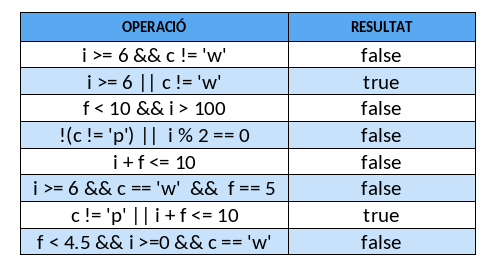
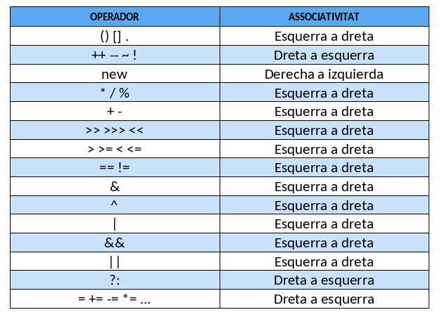

# Operadors en Java
La següent taula mostra tots els operadors del llenguatge Java:
{ style="display: block; margin: auto;" }

A continuació, es detallen només els principals operadors dels anteriorment exposats.

##	Operadores Java aritméticos.
Els operadors aritmètics en Java són:

- + Suma. Los operandos pueden ser enteros o reales
- - Resta. Los operandos pueden ser enteros o reales
- * Multiplicación. Los operandos pueden ser enteros o reales
- / Divisió. Los operandos pueden ser enteros o reales. Si ambos son enteros el resultado es entero. En cualquier otro caso el resultado es real.
- % Reste de la divisió. Los operandos pueden ser de tipo entero o real.

Exemple d'operacions aritmètiques
Suposem que tenim les següents variables:

```java
int a = 10, b = 3;
double v1 = 12.5, v2 = 2.0;
```

En la taula es mostren distintes operacions aritmètiques que podem fer amb aquestes:

{ style="display: block; margin: auto;" }

Com ja s'ha comentat abans, Java és un llenguatge fortament tipat. Per això és important saber de quin tipus és el resultat d'una operació aritmètica si hi intervenen dades de tipus diferents.

En aquelles operacions en què apareixen operands de distint tipus, Java convertix els valors al tipus de dada de major precisió de totes les dades que hi intervenen, i este serà el tipus del resultat. Esta conversió es realitza de manera temporal, només per a fer l'operació. Els tipus de dades originals romanen igual després de l'operació. És molt important tindre-ho en compte per a poder assignar el resultat de l'operació a una variable del mateix tipus.

Pel que fa a la conversió temporal de tipus, els tipus `short`, `byte` i `char` es convertixen automàticament a `int`. Per exemple, donades les següents variables:

```java
int i = 7;
double f = 5.5;
byte b = 1;
double a;
a = 5 / 2; // Es perd la part decimal en l'operació. a contindrà el valor de 2.0
a = 5.0 / 2;  // No es perd la part decimal en l'operació. a contindrà el valor de 2.5
```

{ style="display: block; margin: auto;" }

!!! warning "Compte amb la divisió entera"
    Si tots dos operands d'una divisió són enters (com `5 / 2`), el resultat serà també enter (`2`), descartant automàticament els decimals. Per a obtindre el resultat real (`2.5`), com a mínim un dels operands ha de ser de tipus real (per exemple: `5.0 / 2` o `(double) a / b`).


## Operadors Java relacionals.
Els operadors relacionals comparen dos operands i donen com a resultat de la comparació verdader o fals. Els operadors relacionals en Java són:

- <       Menor que
- \>       Major que
- <=      Menor o igual
- \>=      Major o igual
- !=      Distint
- ==      Igual

Els operands han de ser de tipus primitiu.
Per exemple:

```java
int a = 7, b = 9, c = 7;
```

{ style="display: block; margin: auto;" }

## Operadors Java lògics.
Els operadors lògics s'utilitzen amb operands de tipus boolean. S'utilitzen per a construir expressions lògiques, el resultat de les quals és de tipus `true` o `false`.

Els operadors lògics en Java són:

- && AND. El resultat és verdader si els dos operands són verdaders. El resultat és fals en cas contrari. Si el primer operand és fals no s'avalua el segon, ja que el resultat serà fals.
- || OR. El resultat és fals si els dos operands són falsos. Si un és verdader el resultat és verdader. Si el primer operand és verdader no s'avalua el segon.
- ! NOT. S'aplica sobre un sol operand. Canvia el valor de l'operand de verdader a fals i a l'inrevés.

Les definicions de les operacions OR, AND i NOT s'arrepleguen en unes taules conegudes com a **taules de veritat**.

{ style="display: block; margin: auto;" }
F : Fals
V : Vertader

Com exemple, en la següent taula veiem una sèrie d'expressions lògiques i el seu valor:

```java
int i = 7;
float f = 5.5F;
char c = 'w';
```

{ style="display: block; margin: auto;" }

Les expressions lògiques en Java s'avaluen només fins que s'ha establit el valor cert o fals del conjunt. Quan, per exemple, una expressió serà segur falsa pel valor que ha pres un dels seus operands, no s'avalua la resta de l'expressió.

!!! info "Avaluació en curtcircuit (*Short-circuit evaluation*)"
    En Java, els operadors `&&` i `||` avaluen els seus operands d'esquerra a dreta i s'aturen tan bon punt el resultat global està determinat:
    * En un `&&`, si el primer operand és fals (`false`), el resultat serà fals i el segon operand **mai s'avalua**.
    * En un `||`, si el primer operand és cert (`true`), el resultat serà cert i el segon operand **mai s'avalua**.

## Operadors Java unitaris.
Els operadors unitaris en Java són:

- – + signes negatiu i positiu

- ++ -- increment i decrement

- ! NOT. Negació

Estos operadors afecten un sol operand.

L'operador ++ (operador increment) incrementa en 1 el valor de la variable. Exemple d'operador increment:

```java
int i = 1;
i++; // Esta instrucció incrementa en 1 la variable i.
     // És el mateix que fer i = i + 1; i pren el valor 2
```
L'operador -- (operador decrement) decrementa en 1 el valor de la variable. Exemple d'operador decrement:

```java
int i = 1;
i--; // decrementa en 1 la variable i.
     // És el mateix que fer i = i - 1; i pren el valor 0
```

Els operadors increment i decrement tenen dues formes; la forma *postfix* (o posterior), en què l'operador se situa després de l'operand. També existeix la forma *prefix* (o anterior), `++n`. Ambdues modifiquen el valor de la variable en una unitat. La diferència es manifesta quan s'utilitzen dins d'expressions: la forma *prefix* realitza primer la suma, mentre que la forma *postfix* pren el valor original de la variable.

```java
int m = 7;
int n = 7;
int a = 2 * ++m; // a val 16, m val 8
int b = 2 * n++; // b val 14, n val 8
```

!!! tip "Bona pràctica: aïllar increments i decrements"
    Per a no complicar la comprensió del codi ni provocar efectes secundaris imprevistos, és molt més recomanable escriure `++` i `--` en una línia aïllada i no combinats dins d'expressions complexes.

## Operadors Java d'assignació.
S'utilitzen per a assignar el valor d'una expressió a una variable. Els operands han de ser de tipus primitiu.

Per exemple:

```java
int n;
double m = 2.5;
n = m + 1; // esta instrucció produïx un error de compilació.
```

!!! danger "Incompatibilitat de tipus en l'assignació"
    El valor de l'expressió de la dreta només es pot assignar a la variable de l'esquerra si són del mateix tipus o si el tipus destinatari té un rang de precisió major (per exemple, assignar un `int` a un `double`).
    
    A l'exemple anterior, el resultat de `m + 1` és de tipus `double` i el compilador no permet assignar-lo directament a una variable entera `int n;` per risc de pèrdua d'informació decimal.


En intentar realitzar la instrucció `n = m + 1`; es produirà un error. El resultat de l'operació aritmètica `m + 1` és de tipus `double` i no es pot assignar a una variable de tipus `int`.

En este altre cas l'assignació sí que és possible:

```java
double m;
int n = 2;
m = n + 50;
```

El resultat de l'operació aritmètica `n + 50` és de tipus `int` i `m` és de tipus `double`. Encara que ambdós tipus no coincidixen, l'assignació es pot realitzar perquè el rang de valors d'un `int` és menor que el d'un `double` i per tant no hi pot haver pèrdua d'informació.

En general, en una assignació del tipus `A = B`, si el rang de valors que pot emmagatzemar `A` és major que el rang de valors que pot emmagatzemar `B` aleshores l'assignació es podrà realitzar. Per exemple, si `A` és de tipus `double` i `B` de tipus `float` l'assignació `A = B` es pot fer, però no es podrà realitzar en cas contrari (sent `A float` i `B double`).

De vegades ens pot interessar emmagatzemar dades en variables, tot i sabent que hi haurà pèrdua d'informació. Un exemple clàssic és emmagatzemar un número de tipus real (per exemple 4,7) en una variable de tipus enter (emmagatzemant 4 i perdent, per tant, la part decimal).

Seguint les normes descrites anteriorment, açò no es podria realitzar, ja que el tipus de dades real és major que el tipus de dades enteres. En estos casos es pot fer una conversió explícita de dades utilitzant el mecanisme anomenat càsting de tipus (*casting*).

```java
int num = (int) 4.7; // Converteix 4.7 a enter i l'emmagatzema en la variable num
```

!!! tip "Com funciona el càsting a enter?"
    Quan es converteix un número de tipus real (`double` o `float`) a enter (`int`), Java **trunca** la part decimal; no arrodoneix. Per tant, `(int) 4.7` resulta en `4` i `(int) 9.99` resulta en `9`.

Per últim, cal indicar que en Java estan permeses les assignacions múltiples. Per exemple:

```java
a = b = c = 3;   // equival a:   a = 3; b = 3; c = 3;
```

L'assignació de valor a les variables en una assignació múltiple es realitza de dreta a esquerra. En l'exemple, primer s'assigna el valor 3 a `c`, a continuació, el valor de `c` s'assigna a `b` i finalment el valor de `b` se li assigna a la variable `a`.

## Prioritat i ordre d'avaluació dels operadors en Java.
La següent taula mostra tots els operadors Java ordenats de major a menor prioritat. La primera fila de la taula conté els operadors de major prioritat i l'última els de menor prioritat. Els operadors que apareixen en la mateixa fila tenen la mateixa prioritat. Una expressió entre parèntesis sempre s'avalua primer i si estan niats s'avaluen dels més interns als més externs.

{ style="display: block; margin: auto;" }

!!! tip "Bona pràctica: useu parèntesis `( )`"
    Tot i que existisca una taula oficial de precedència, és altament aconsellable utilitzar parèntesis per a agrupar operacions. D'aquesta manera s'eviten errors d'interpretació per part del programador i el codi s'entén d'un cop d'ull.

El següent exemple té en compte la prioritat i l'ordre d'avaluació d'operadors:


```java
int a, b, c;
a = 4 * 5 / 3 + 6; // el resultat serà 12

// Trenquem l'orde establit per la prioritat d'operadors.
b = 4 * 5 / (3 + 6); // el resultat serà 2. 

// Trenquem l'orde establit per l'associativitat d'esquerra a dreta 
// per a la mateixa prioritat d'operadors.
c = 4 * (5 / 3) + 6; // el resultat serà 10.
```