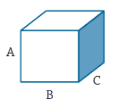
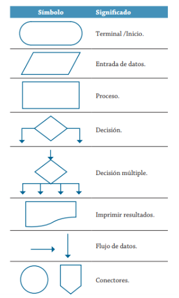
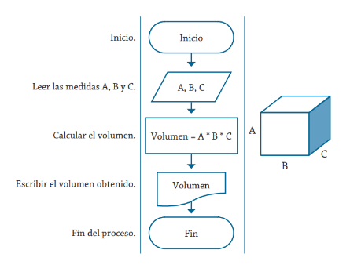
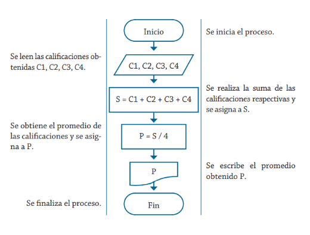
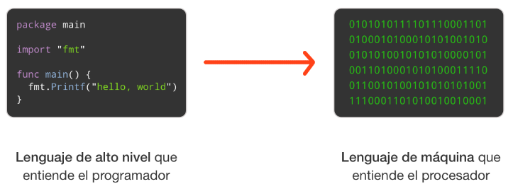

# Representacions d'algorismes

## Concepte d'algorisme

No tots els mètodes de solució d'un problema són susceptibles de ser utilitzats per un computador. Perquè un procediment puga ser implementat en un computador ha de complir determinats requisits:

- Ha d'estar compost d'accions ben definides.
- Ha d'estar format per una seqüència finita d'operacions amb un ordre definit.
- Finalment, ha d'acabar en un temps finit.

Es pot donar la següent definició d'algorisme: un algorisme és un procediment no ambigu que resol un problema. Un procediment és una seqüència d'operacions ben definides, cadascuna de les quals requereix una quantitat finita de memòria i es realitza en un temps finit.

## Pseudocodi
El pseudocodi és un llenguatge que permet passar quasi de manera directa la solució del problema a un llenguatge de programació específic. El pseudocodi és una sèrie de passos ben detallats i clars que condueixen a la resolució d'un problema. La facilitat de passar quasi de manera directa el pseudocodi a la computadora ha donat com a resultat que molts programadors implementen de manera directa els programes en la computadora.

Exemple 1: El pseudocodi per a determinar el volum d'una caixa de dimensions A, B i C es pot establir de la següent manera:
 
{ style="float: right;" }

1. Inici
2. Llegir les mesures A, B i C
3. Realitzar el producte d'A * B * C i guardar-lo en V (V = A * B * C)
4. Escriure el resultat V
5. Fi

Com es pot veure, s'estableix de manera precisa la seqüència dels passos a realitzar; a més, si se'ls proporciona sempre els mateixos valors a les variables A, B i C, el resultat del volum serà el mateix i, per consegüent, es compta amb un final.

## Diagrames de flux
Els diagrames de flux permeten representar visualment quines operacions es requereixen i en quina seqüència s'han d'efectuar per a solucionar un problema.

Els diagrames de flux exerceixen un paper vital en la programació d'un problema, ja que faciliten la comprensió de problemes complicats i sobretot els processos que són molt llargs; generalment, els diagrames de flux es dibuixen abans de començar a programar el codi font, el qual s'inserirà posteriorment en l'ordinador.

Dins dels diagrames de flux es poden utilitzar els símbols que es presenten a continuació, amb els quals s'indiquen les operacions que s'efectuaran sobre les dades per a produir un resultat. En aquesta primera UT tan sols es tractaran les estructures seqüencials, per la qual cosa no utilitzarem els símbols associats a operacions de decisió.

{ style="display: block; margin: auto;" }

Exemple 2: A continuació es mostra la solució del diagrama de flux per a determinar el volum d'una caixa de dimensions A, B i C.

{ style="display: block; margin: auto;" }

Com es pot veure de manera gràfica, s'estableix de manera precisa la seqüència dels passos per realitzar per a obtindre el resultat del volum. Com es pot verificar, són els mateixos passos que es van establir en l'algorisme presentat prèviament mitjançant el pseudocodi.

### Estructures seqüencials.
En aquest tipus d'estructura les instruccions es realitzen o s'executen una després de l'altra i, en general, s'espera que es proporcione una o diverses dades, les quals són assignades a variables perquè amb elles es produïsquen els resultats que representen la solució del problema.

Exemple 3: Es desitja implementar un algorisme per a obtindre la suma de dos números qualsevol. S'ha de partir que per a poder obtindre la suma és necessari comptar amb dos números, perquè el procés que hem de realitzar és precisament la suma d'aquests, la qual s'assigna a una variable que es mostra com a resultat del procés.

És recomanable indicar mitjançant una taula les variables que s'utilitzen, assenyalant el que representen i les seues característiques, aquesta acció facilitarà la lectura de la solució d'un problema donat, sense importar quina eina de programació s'estiga utilitzant per a la representació de la solució. Per al problema de la suma de dos números, la taula següent mostra les variables utilitzades en la solució.

{ style="display: block; margin: auto;" }

Els passos per seguir són els mostrats en el pseudocodi següent, que correspon a l'algorisme que permet determinar la suma de dos números qualsevol.

1.	Inici 
2.	Llegir A, B 
3.	Realitzar S = A + B 
4.	Escriure S 
5.	Fi

La representació del algorisme mitjaçant la utilització d'un diagrama de flux seria com el que es mostra en el diagrama següent.

{ style="display: block; margin: auto;" }

Exemple 4: Un estudiant realitza quatre exàmens durant el trimestre, els quals tenen la mateixa ponderació. Realitza el pseudocodi i el diagrama de flux que representen l'algorisme necessari per a obtindre el promedi de les qualificacions obtingudes.

Les variables que es van a utilitzar en la solució d'este problema es mostren en la taula següent.

{ style="float: right;" }

1.	Inici 
2.	Llegir C1, C2, C3, C4 
3.	Realitzar S = C1 + C2 + C3 + C4 
4.	Realitzar P = S/4 
5.	Escriure P 
6.	Fi

## Llenguatges de programació
Un llenguatge de programació és un conjunt de símbols i de regles necessàries per a combinar-los, els quals s'usen per a expressar algorismes. Els llenguatges de programació tenen un lèxic (conjunt de símbols permesos), una sintaxi (indica com realitzar les construccions del llenguatge) i una semàntica (determina el significat de cada construcció).

{ style="display: block; margin: auto;" }

### Característiques
Els llenguatges de programació, o llenguatges d'alt nivell, estan específicament dissenyats per a programar computadors. Tenen les següents característiques fonamentals:

- Són independents de l'arquitectura del computador. 
- Normalment, una sentència en un llenguatge d'alt nivell requereix de diverses instruccions en llenguatge màquina. 
- Utilitzen notacions properes a les habituals en l'àmbit en les quals s'usen.

Com a conseqüència d'aquest allunyament de la màquina i apropament a les persones, els programes escrits en llenguatges de programació no poden ser directament interpretats pel computador, sent necessari realitzar prèviament la seua traducció a llenguatge màquina.

### El procés de traducció
Com l'ordinador pot interpretar i executar només el codi de la màquina, hi ha traductors que tradueixen programes escrits en llenguatges de programació a llenguatge màquina. El programa inicial s'anomena programa font i el programa obtingut, programa objecte.

Un **compilador** tradueix un programa font, escrit en un llenguatge d'alt nivell, en un programa objecte, escrit en llenguatge d'assemblador o màquina. El programa font normalment es troba en un fitxer, i el programa objecte es pot emmagatzemar com un fitxer que s'ha de processar més tard, sense necessitat de tornar a realitzar la traducció. 

Un **intèrpret** fa que un programa font escrit en un idioma vaja, línia a línia, traduint i executant directament a través de l'ordinador. L'intèrpret captura una linia font, l'analitza i l'interpreta donant lloc a la seua execució immediata, sense crear cap arxiu o objecte de programa per a noves execucions.

Un **compilador Just-In-Time** (**JIT**) (compilador en temps d'execució) representa un model híbrid que combina els avantatges dels compiladors i dels intèrprets. En aquest enfocament, el programa font no es tradueix directament a codi màquina, sinó a un codi intermedi independent del maquinari (**bytecode**). 

Un error molt comú és pensar que el JIT compila constantment el mateix codi. La clau del seu alt rendiment és que **només compila una vegada** les parts més utilitzades del programa (*hot spots*). Un cop el *bytecode* d'un bucle o mètode s'ha traduït a codi màquina, el JIT l'emmagatzema a la memòria cau. A partir d'eixe moment, qualsevol execució futura d'eixe codi utilitzarà directament la versió compilada, sense cap cost addicional de traducció.
