# Estructures condicionals
## Estructures condicionals amb pseudocodi i diagrames de flux.

Els algorismes, en determinats moments, requereixen ser selectius pel que fa a les accions que han de seguir. D'ací ve que les estructures selectives per als algorismes siguen tan importants, de manera que en la majoria dels problemes es té present una estructura selectiva, que implica seguir o no un determinat flux de seqüència del problema.

En els algorismes per a la solució de problemes on s'utilitzen estructures selectives s'utilitzen frases que estan estructurades de forma adequada dins del pseudocodi. En el cas del diagrama de flux, també s'estructura d'una forma pareguda.

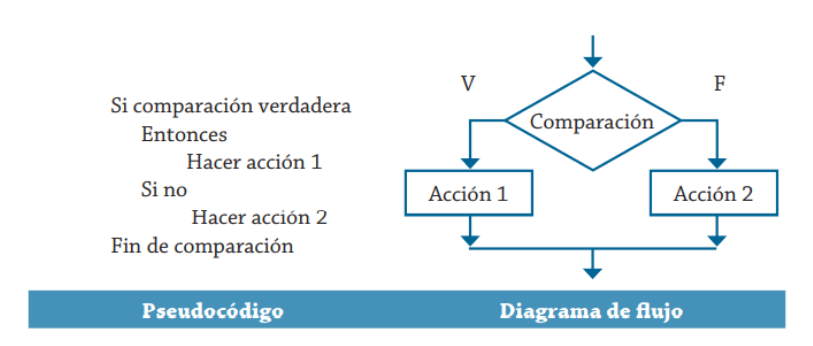{ style="display: block; margin: auto; width: 500px;" }


**Exemple 1**. Es desitja implementar un algorisme per determinar quin dels dos valors proporcionats és el major. Representa-ho amb pseudocodi i diagrama de flux.

Es pot establir que les variables que s'han d'utilitzar són les mostrades en aquesta taula.

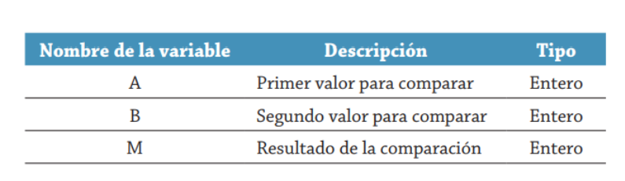{ style="display: block; margin: auto; width: 500px;" }


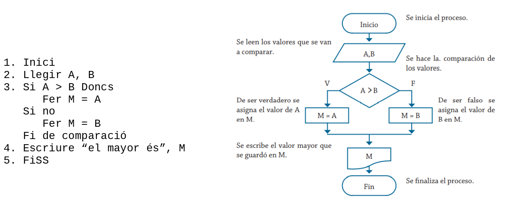{ style="display: block; margin: auto;" }

**Exemple 2**. Realitza un algorisme per determinar si un número és positiu o negatiu. Representa-ho en pseudocodi i diagrama de flux.
Per a aquest cas, la taula següent mostra les variables que es requereixen en la solució del problema.


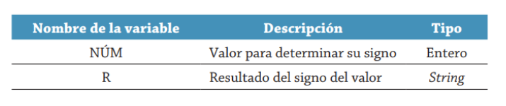{ style="display: block; margin: auto; width: 500px;" }


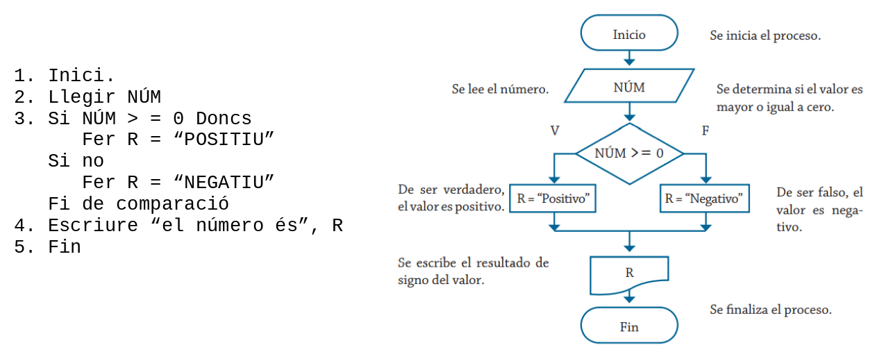{ style="display: block; margin: auto;" }

Fins ara, els problemes vists només presenten una decisió per realitzar un determinat procés; no obstant això, en algunes ocasions és necessari elaborar estructures selectives en cascada o niades, això significa que després d'haver realitzat una comparació selectiva és necessari realitzar una altra comparació selectiva com a resultat de la primera condició. En la figura següent es presenten les formes correcta i incorrecta d'estructurar el pseudocodi per a aquest cas:

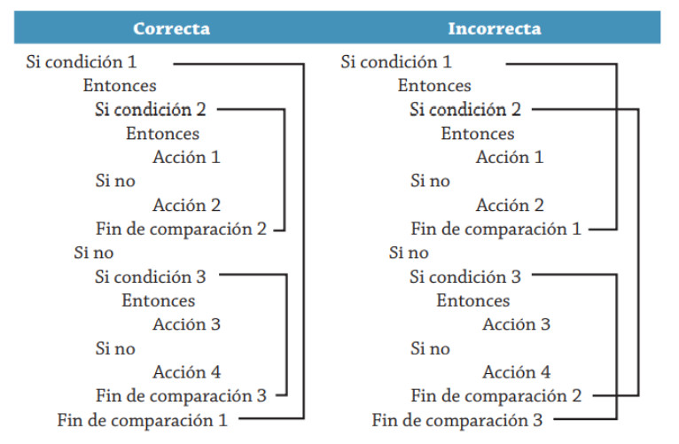{ style="display: block; margin: auto; width: 500px;" }

El seu diagrama de flux seria:

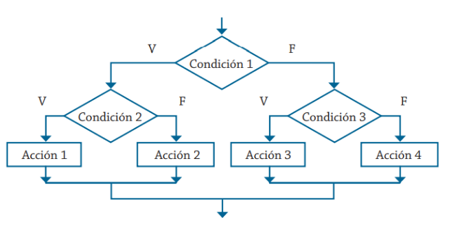{ style="display: block; margin: auto; width: 500px;" }

**Exemple 3**. Es requereix determinar quina de les tres quantitats proporcionades és la major. Realitza el seu respectiu algorisme i representa'l mitjançant un diagrama de flux i pseudocodi. Les variables que intervenen en la solució d'aquest problema es mostren a continuació.

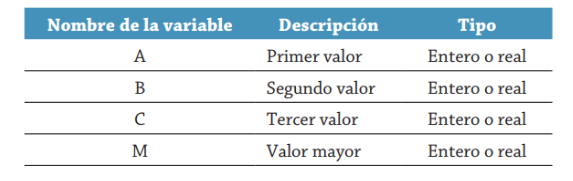{ style="display: block; margin: auto; width: 500px;" }

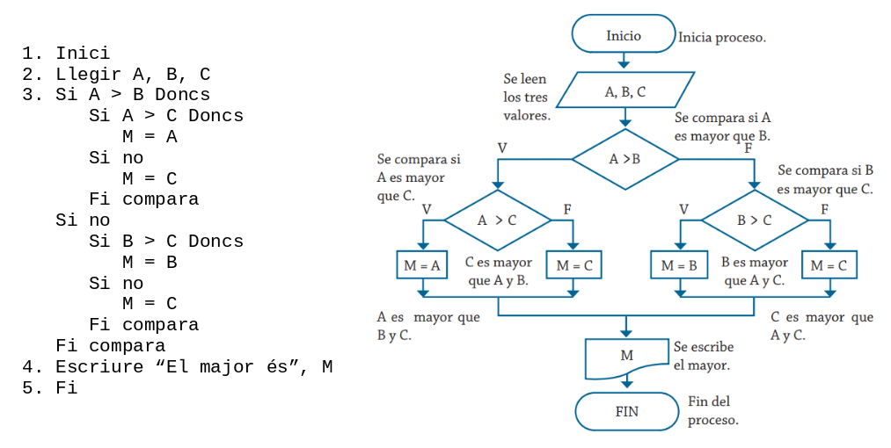{ style="display: block; margin: auto;" }

## Estructures condicionals amb Java.
En Java l'estructura condicional s'implementa mitjançant:   

- Instrucció if.
- Instrucció switch.
- Instrucció condicional ? :  
  
### Instrucció IF
Pot ser del tipus:

- Condicional simple: if   
- Condicional doble: if … else …   
- Condicional múltiple: if … else if …   
 
La condició ha de ser una **expressió booleana** (condició), és a dir, ha de donar com a resultat un valor booleà (`true` o `false`).

#### Condicional simple
S'avalua la condició i si aquesta es compleix s'executa una determinada acció o grup d'accions. En cas contrari se salten aquest grup d'accions.   

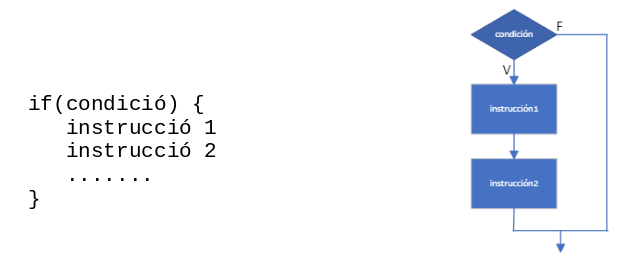{ style="display: block; margin: auto; width: 500px;" }


!!! tip "Bona pràctica: ús sistemàtic de claus `{ }`"
    Encara que Java permet ometre les claus `{ }` quan el bloc conté una única instrucció, és **altament recomanable escriure-les sempre**. D'aquesta manera s'eviten errors de lògica greus en afegir una segona sentència posteriorment.

**Exemple 4**. Programa Java amb estructura condicional.
   

```java
/*
 * Programa que demana una nota per teclat i mostra un missatge si la nota   
 * és major o igual que 5
 */

void main() {
    int nota;
    
    IO.print("Nota: ");
    nota = Integer.parseInt(IO.readln());

    if (nota >= 5) {
        IO.println("Enhorabona!!");
        IO.out.println("Has aprovat");
    }
}
```

#### Condicional doble
S'avalua la condició i si aquesta es compleix s'executa una determinada instrucció o grup d'instruccions. Si no es compleix s'executa una altra instrucció o grup d'instruccions.   

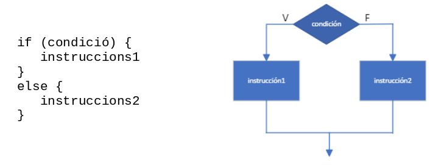{ style="display: block; margin: auto; width: 500px;" }

**Exemple 5**. Programa Java que conté una estructura condicional doble.   

```java
/*
 * Programa que demana una nota per teclat i mostra si s'ha aprovat o no
 */

void main() {
    int nota;

    IO.print("Nota: ");
    nota = Integer.parseInt(IO.readln());
    
    if (nota >= 5) {
        IO.println("Enhorabona!!");
        IO.println("Has aprovat");
    }
    else {
        IO.out.println("Ho sent, has suspès");
    }
}
```

**Exemple 6**. Programa Java que conté una estructura condicional doble.   

```java
/*
 * Programa que demana un número per teclat i calcula si és parell o imparell
 */
void main() {
    int num;
    
    IO.println("Introduïu número: ");
    num = Integer.parseInt(IO.readln());
		
    if ((num % 2) == 0)
        IO.println("PARELL"); // Només hi ha 1 instrucció
    else
        IO.println("IMPARELL");
}
```

#### Condicional múltiple
S'obté niant sentències `if … else`. Permet construir estructures de selecció més complexes.

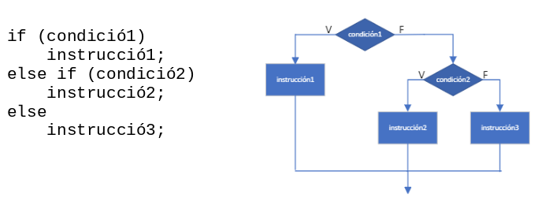{ style="display: block; margin: auto; width: 500px;" }

Cada `else` es correspon amb l'`if` més pròxim que no haja estat emparellat. Una vegada que s'executa un bloc d'instruccions, l'execució continua en la següent instrucció que aparega després de les sentències `if … else` niades.   

!!! warning "Compte amb l'associació d'if i else
    Quan s'escriuen condicionals niats sense claus, el compilador associa sempre el `else` a l'`if` immediatament anterior no tancat, independentment de la indentació que tinga el codi. L'ús de claus `{ }` és la millor garantia per a evitar aquest error.

**Exemple 7**. Programa Java que conté una estructura condicional múltiple.
   

```java
/*
 * Programa que mostra una salutació diferent segons l'hora introduïda
 */
void main() {
    int hora;
    
    IO.print("Introduïu una hora (un valor enter): ");
    hora = Integer.parseInt(IO.readln());
    
    if (hora >= 0 && hora < 12)
        IO.println("Bon dia");
    else if (hora >= 12 && hora < 21)
        IO.println("Bona vesprada");
    else if (hora >= 21 && hora < 24)
         IO.println("Bona nit");
    else
        IO.println("Hora no vàlida");
}
```


**Exemple 8**. Programa Java que conté una estructura condicional múltiple.   

```java
/*
 * programa que llegeix una nota i escriu la qualificació corresponent
 */
void main() {  
    double nota;
      
    IO.print("Introduïu una nota entre 0 i 10: ");
    nota = Double.parseDouble(IO.readln());
    
    IO.print("La qualificació de l'alumne és ");
    
    if (nota < 0 || nota > 10)
        IO.println("Nota no vàlida");
    else if (nota == 10)
        IO.println("Matrícula d'Honor");
    else if (nota >= 9)
        IO.println("Excel·lent");
    else if (nota >= 7)
        IO.println("Notable");
    else if (nota >= 6)
        IO.println("Bé");
    else if (nota >= 5)
        IO.println("Suficient");
    else
        IO.println("Suspès");
}
```

##### Comparar String en Java
Per comparar el contingut de dues cadenes en Java s'usa el mètode `equals`:   

```java
if (cadena1.equals(cadena2)) // cadena1 i cadena2 són variables de tipus String
```

!!! warning "Compte: no useu `==` per a comparar el contingut de dos Strings"
    En Java, les cadenes de caràcters (`String`) són objectes. L'operador `==` no compara els caràcters del text, sinó si dos variables apunten exactament a la mateixa referència de memòria.
    
    Quan es lligen textos de l'usuari mitjançant teclat (per exemple amb `IO.readln()`), `cadena == "Lucas"` avaluarà a `false` encara que l'usuari haja escrit la paraula `"Lucas"`. Per tant, per a comparar cadenes per valor s'ha d'utilitzar **sempre** el mètode `.equals()`.

Per comparar Strings en l'ordre alfabètic s'usa el mètode `compareTo`:   

```java
if (cadena1.compareTo(cadena2) < 0) // cadena1 va abans que cadena2
if (cadena1.compareTo(cadena2) > 0) // cadena1 va després que cadena2
if (cadena1.compareTo(cadena2) == 0) // cadena1 és igual que cadena2
```


### Operador condicional ? :
Es pot utilitzar en substitució de la sentència de control `if-else`. Els formen els caràcters `?` i `:`

S'utilitza de la forma següent:   

```java
expressió1 ? expressió2 : expressió3
```

Si `expressió1` és certa llavors s'avalua `expressió2` i aquest serà el valor de l'expressió condicional. Si `expressió1` és falsa, s'avalua `expressió3` i aquest serà el valor de l'expressió condicional.   

!!! tip "Quan emprar l'operador ternari `? :`"
    L'operador ternari és ideal per a assignacions senzilles o missatges directes. Si la lògica és complexa o conté més d'una sentència, és preferible utilitzar una estructura `if-else` tradicional per claredat i mantenibilitat.

**Exemple 9**. Programa Java que conté un operador condicional.
   

```java
/*
 * programa que demana un número per teclat i calcula si és parell o imparell
 */
void main() {
    int num;
    
    IO.println("Introduïu número: ");
    num = Integer.parseInt(IO.readln());
    
    IO.println((num % 2) == 0 ? "PARELL" : "IMPARELL");
}
```

### Instrucció switch
S'utilitza per seleccionar una d'entre múltiples alternatives. 

La sintaxi clàssica de la instrucció switch en Java és la següent:

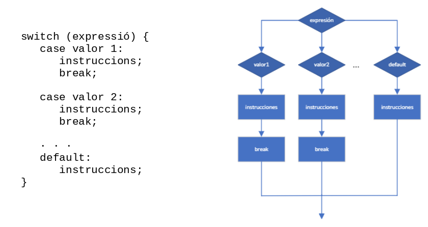{ style="display: block; margin: auto; " } 


El funcionament d'aquesta sintaxi és el següent:

- Primer s'avalua l'expressió i salta al case la constant del qual coincidisca amb el valor de l'expressió.
- S'executen les instruccions que segueixen al case seleccionat fins que es troba un break o fins al final del switch. El break produeix un salt a la següent instrucció a continuació del switch.
- Si cap d'aquests casos es compleix s'executa el bloc default (si existeix). No és obligatori que existisca un bloc default i no té per què posar-se sempre al final, encara que és l'habitual.

!!! warning "Compte amb la sentència `break` en el switch clàssic"
    En la sintaxi tradicional amb dos punts `:`, si oblideu posar `break;`, l'execució continuarà ("caurà" o *fallthrough*) cap a les instruccions del següent `case`, executant accions no desitjades fins a trobar un altre `break` o el final del bloc.

A partir de la versió 14 de Java es pot utilitzar amb la següent sintaxi:


```java
switch (expressió) {
    case valor1 -> {
        instruccions;
    }
    
    case valor2 -> {
      instruccions;
    }
    · · ·
    default -> {
      instruccions;
    }
}
```

Tradicionalment s'ha utilitzat com una instrucció (*statement*), però en les versions més recents de Java el `switch` s'ha millorat per a poder utilitzar-se de quatre formes diferents. Les 2 primeres formes s'utilitzen com a instrucció (només per a executar codi).

Les altres formes funcionen com a **Expressió** (per a retornar un valor i assignar-lo directament a una variable), tenint l'opció d'utilitzar la nova sintaxi amb fletxa `->` (sense caiguda o *No Fallthrough*) o la clàssica amb dos punts `:` (amb caiguda o *Fallthrough*).

!!! info "Tipus permesos en el switch i agrupació de casos"
    * La instrucció `switch` es pot usar amb dades de tipus `byte`, `short`, `char`, `int`, enumerats i `String`.
    * Les versions modernes permeten agrupar múltiples valors en un mateix `case` separant-los per comes (per exemple: `case "Summer", "Winter"` o `case 1, 2, 3 ->`) evitant duplicar codi.


#### Instrucció amb : (Fallthrough Statement - Forma Clàssica)
És el comportament tradicional. Primer s'avalua l'expressió i salta al case coincident. L'execució continua cap avall passant pels casos següents (fallthrough) fins que es troba un break o s'arriba al final del switch.   

```java
switch (seasonName) {
   case "Spring":
      IO.println("spring time!");
   case "Summer", "Winter":
      numLetters = 6;
      break;
   case "Fall":
      numLetters = 4;
      break;
   default:
      numLetters = -1;
}
```

#### Instrucció amb fletxa -> (No Fallthrough Statement)
Aïlla cada cas de manera independent. Si hi ha coincidència, només s'executa el codi que hi ha a la dreta de la fletxa i el switch acaba automàticament sense necessitat d'utilitzar la instrucció break.   

```java
switch (seasonName) {
    case "Spring" -> {
        IO.println("spring time!");
        numLetters = 6;
    }
    case "Summer", "Winter" -> numLetters = 6;
    case "Fall" -> numLetters = 4;
    default -> numLetters = -1;
}
```

#### Expressió amb fletxa -> (No Fallthrough Expression)
Permet assignar el resultat final del switch directament a una variable (com int numLetters = switch(...)). A la dreta de la fletxa es pot posar directament el valor que es vol retornar. Si es requereix executar diverses instruccions dins d'un mateix case, s'obrin claus {} i s'utilitza la nova paraula clau yield per a indicar quin serà el valor que es retornarà. 

```java
int numLetters;
numLetters = switch (seasonName) {
    case "Spring" -> {
        IO.println("spring time!");
        yield 6;
    }
    case "Summer", "Winter" -> 6;
    case "Fall" -> 4;
    default -> -1;
}; // Cal posar punt i coma en acabar l'expressió
```


#### Expressió amb : (Fallthrough Expression)
També assigna el resultat a una variable, però manté el comportament tradicional de "caure" cap als casos inferiors (fallthrough). És obligatori utilitzar yield per a retornar el valor final i aturar l'execució. Si un case no té yield (com al cas "Spring" de l'exemple), s'executen les seues instruccions i l'execució continua caient al cas següent fins a trobar un yield que retorne el valor definitiu.   


```java
int numLetters;
numLetters = switch (seasonName) {
    case "Spring":
        IO.println("spring time!");
        // Ací no hi ha yield, així que l'execució "cau" al següent cas
    case "Summer", "Winter":
        yield 6;
    case "Fall":
        yield 4;
    default:
        yield -1;
};
```


**Exemple 10**. Programa Java que conté una instrucció switch.   

```java
/*
 * Programa que demana un número de mes i mostra el nom corresponent
 */
void main() {
    int mes;
    
    IO.print("Introduïu un número de mes: ");
    mes = Integer.parseInt(IO.readln());

    switch (mes) {
        case 1:  IO.println("GENER");
                 break;
        case 2:  IO.println("FEBRER");
                 break;
        case 3:  IO.println("MARÇ");
                 break;
        case 4:  IO.println("ABRIL");
                 break;
        case 5:  IO.println("MAIG");
                 break;
        case 6:  IO.println("JUNY");
                 break;
        case 7:  IO.println("JULIOL");
                 break;
        case 8:  IO.println("AGOST");
                 break;
        case 9:  IO.println("SETEMBRE");
                 break;
        case 10: IO.println("OCTUBRE");
                 break;
        case 11: IO.println("NOVEMBRE");
                 break;
        case 12: IO.println("DESEMBRE");
                 break;
        default: IO.println("Mes no vàlid");
    }
}
```
**Exemple 11**. Programa Java que conté una instrucció switch.

```java
/*
 * Programa que demana dos números i un operador, i mostra el resultat
 */
void main() {
    int A, B, resultat = 0;
    char operador;
    boolean calculat = true;
      
    IO.print("Introduïu un número enter:");
    A = Integer.parseInt(IO.readln());
    IO.print("Introduïu un altre número enter:");
    B = Integer.parseInt(IO.readln());
    IO.print("Introduïu un operador (+,-,*,/):");
    
    //Llegeix un caràcter. No existeix el mètode Character.parseChar
    operador = IO.readln().charAt(0); 
    switch (operador) {
        case '-': resultat = A - B;
                  break;
        case '+': resultat = A + B;
                  break;
        case '*': resultat = A * B;
                  break;
        case '/': if (B != 0) {
                      resultat = A / B;
                  }
                  else {
                      IO.println("\nNo es pot dividir per zero");
                      calculat = false;
                  }
                  break;
        default: IO.println("\nOperador no vàlid");
                 calculat = false;
    }
    if (calculat)
        IO.println("\nEl resultat és: " + resultat);
}
```

!!! tip "Lectura de caràcters per consola"
    Com que a Java no existeix una funció directa tipus `Character.parseChar`, per a obtindre un caràcter a partir del text llegit amb `IO.readln()` s'utilitza el mètode `.charAt(0)`, que pren el caràcter situat a la posició inicial (índex 0).

---


!!! tip "Exercicis resolts"
    Podeu consultar més casos pràctics resolts pas a pas d'estructures selectives a l'apartat d'[Exercicis resolts: Estructures condicionals](exemples.md#estructures-condicionals).

