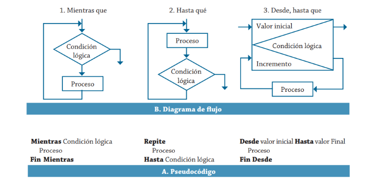
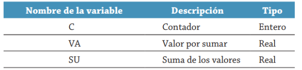
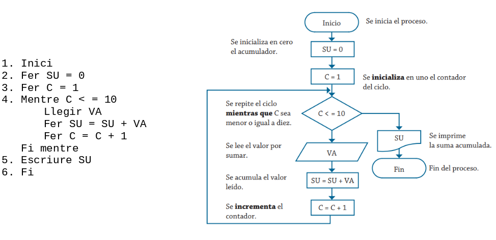
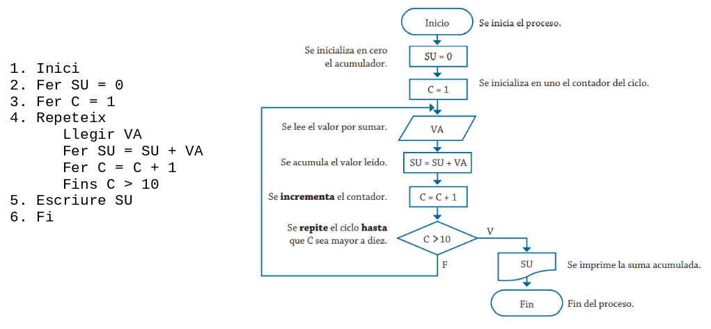
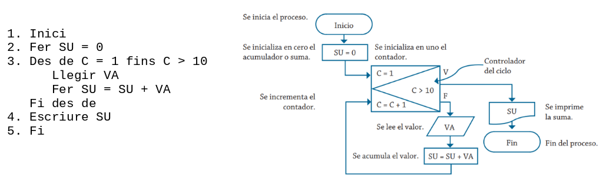
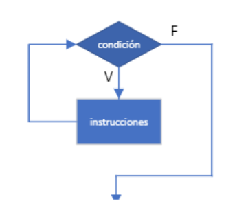
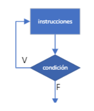
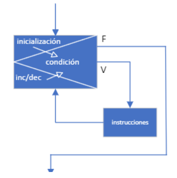

# Estructures repetitives

Quan es requereix que un procés s'efectue de manera cíclica, s'utilitzen estructures que permeten el control de cicles. Aquestes estructures s'utilitzen basant-se en les condicions pròpies de cada problema. Els noms amb els quals es coneixen són: “Mentre”, “Repeteix fins a” i “Des de … fins a”.  

Per al cas de l'estructura “Mentre”, el cicle es repeteix mentre que la condició lògica siga vertadera; en canvi, en l'estructura “Fins a”, el cicle es repeteix sempre que el resultat de la condició lògica siga fals; a més, com es pot veure a la figura següent, en l'estructura “Mentre” primer s'avalua i després es realitza el procés; i per al cas de “Fins a”, primer es realitza el procés i després s'avalua, per consegüent aquest tipus d'estructura sempre realitzarà almenys un procés.   

{ style="display: block; margin: auto; " } 

!!! info "Resum: Quan utilitzar cada estructura repetitiva?"
    * **Mentre (`while`):** La condició s'avalua **a l'inici**. Si la condició és falsa des del principi, el bloc **no s'executarà mai** (0 o més iteracions). Útil quan no sabem quantes vegades cal repetir o depenem d'un valor sentinella.
    * **Repeteix fins a (`do-while`):** La condició s'avalua **al final**. El bloc s'executarà **sempre com a mínim una vegada** (1 o més iteracions). Ideal per a la validació d'entrades per teclat.
    * **Des de... fins a (`for`):** El nombre d'iteracions és **conegut prèviament** o fixat abans d'iniciar el cicle. L'increment o decrement de la variable de control és automàtic a cada volta.

Les estructures de tipus “Des de … fins a” s'apliquen quan es té definit el número de vegades que es realitzarà el procés dins del cicle, la qual cosa la fa diferent de les altres és que aquelles es poden utilitzar fins que les condicions canvien dins del mateix cicle, aquestes condicions poden deure's a una dada proporcionada des de l'exterior, o bé, al resultat d'un procés executat dins del mateix, el qual marca el final. A més, en el cicle “Des de … fins a”, el seu increment és automàtic, per la qual cosa no s'ha d'efectuar mitjançant un procés addicional, com en els altres dos tipus. En els següents exemples es mostrarà l'aplicació dels tres tipus de cicles abans esmentats.
   

**Exemple 1**. Es requereix un algorisme per a obtindre la suma de deu quantitats mitjançant la utilització d'un cicle “Mentre”. Realitza el diagrama de flux i el pseudocodi.  

{ style="display: block; margin: auto; " } 

La solució d'aquest problema mitjançant el cicle Mentre, que també és conegut com a cicle While en els diferents llenguatges de programació. 

{ style="display: block; margin: auto; " } 


**Exemple 2**. Es requereix un algorisme per a obtindre la suma de deu quantitats mitjançant la utilització d'un cicle Repeteix. Realitza el diagrama de flux i el pseudocodi.
El cicle Repeteix fins a també és conegut com a cicle Do-While en els diferents llenguatges de programació. Les variables que es requereixen són les que es mostren en la taula de l'exemple anterior.   

{ style="display: block; margin: auto; " } 

**Exemple 3**. Es requereix un algorisme per a obtindre la suma de deu quantitats mitjançant la utilització d'un cicle Des de. Realitza el diagrama de flux i el pseudocodi.
El cicle Des de...fins a també és conegut com a cicle For en els diferents llenguatges de programació. S'utilitzaran les mateixes variables que en els dos exemples anteriors.   

{ style="display: block; margin: auto; " } 

## Estructures repetitives en Java.

En Java les estructures repetitives existents executen les instruccions **mentre** es complisca una determinada condició.

Tipus d'estructures repetitives:   

- Cicle while.   
- Cicle do – while.   
- Cicle for.   

### Cicle while
Les instruccions es repeteixen mentre la condició siga certa. La condició es **comprova al principi** del bucle per la qual cosa les accions es poden executar **zero o més vegades**.

L'execució del bucle while segueix els següents passos:   

1.  Primer s'avalua la condició.
2.  Si el resultat és *false*, les instruccions no s'executen i el programa continua executant-se per la següent instrucció a continuació del *while*.   
3.  Si el resultat és *true*, s'executen les instruccions del *while* i es torna al pas 1.   
  
{ style="display: block; margin: auto; " } 
 
**Exemple 4**. Programa Java que conté una instrucció while.  

```java
/*
 * Programa que llegeix números fins que es llegeix un negatiu i mostra la
 * suma dels números llegits
 */
void main() {
   int suma = 0, num;
   
   IO.print("Introduïu un número: ");
   num = Integer.parseInt(IO.readln());
   
   while (num >= 0) {
      suma = suma + num;
      IO.print("Introduïu un número: ");
      num = Integer.parseInt(IO.readln());
   }

   IO.println("La suma és: " + suma);
}
```

**Exemple 5**. Programa Java que conté una instrucció while.   

```java
/*
 * programa que llegeix un número n i mostra n asteriscs
 */
void main() {
   int n, comptador = 0;
   
   IO.print("Introduïu un número: ");
   n = Integer.parseInt(IO.readln());
   
   while (comptador < n) {
      IO.println(" * ");
      comptador++;
   }
}
```

**Exemple 6**. Programa Java amb una instrucció while.   

```java
/*
 * Programa que mostra una taula d'equivalències entre
 * graus Fahrenheit i graus celsius
 */
void main() {
   final int VALOR_INICIAL = 10; // límit inferior en taula
   final int VALOR_FINAL = 100; // límit superior en taula
   final int PAS = 10; // increment
   int fah; //fahrenheit
   double cel; //celsius
   
   fah = VALOR_INICIAL;
   IO.println("Fahrenheit \t Celsius");
   
   while (fah <= VALOR_FINAL) {
      cel = 5 * (fah - 32) / 9.0;
      IO.println(fah + "\t" + cel);
      fah = fah + PAS;
   }
}
```

### Cicle do-while
Les instruccions s'executen mentre la condició siga certa. La condició es **comprova al final** del bucle, per la qual cosa el bloc d'instruccions s'executarà **almenys una vegada**.

Aquesta és la diferència fonamental amb la instrucció while. Les instruccions d'un bucle while no s'executaven si la condició inicialment era falsa.

L'execució del bucle do - while segueix els següents passos:   

1. Primer s'executen les instruccions a partir de do {...  
2. S'avalua la condició.   
3. Si el resultat és false, el programa continua executant-se per la següent instrucció a continuació del while.   
4. Si el resultat és true, es torna al pas 1.   

{ style="display: block; margin: auto; " } 

Mentre que en l'anterior apartat es va introduir el concepte d'estructura clàssica repetir-fins a, el do-while de Java seria una estructura repetir-mentre.   

!!! warning "Diferència clau en la condició de Java `do-while`"
    En pseudocodi clàssic, *Repeteix fins a* s'atura quan la condició és certa. En canvi, a Java el `do-while` continua iterant **mentre la condició siga certa** (`true`) i només finalitza quan s'avalua a falsa (`false`).

!!! tip "Cas d'ús ideal de `do-while`: Validació d'entrades per teclat"
    El bucle `do-while` és el patró estàndard per a obligar l'usuari a introduir una dada correcta, ja que com a mínim cal demanar el valor una primera vegada abans de poder comprovar si compleix els requisits.

**Exemple 7**. Programa Java que conté una instrucció do - while.
   

```java
/*
 * Programa que obliga l'usuari a introduir un número menor que 100
 */
void main() {
   int valor;
   
   do {
      IO.print("Escriu un enter < 100: ");
      valor = Integer.parseInt(IO.readln());
   } while (valor >= 100);
   
   IO.println("Heu introduït: " + valor);
}
```

**Exemple 8**. Programa Java que conté una instrucció do – while.   

```java
/*
* Programa que llegeix un número entre 1 i 10 ambdós inclosos
*/
void main() {
   int n;
   
   do {
      IO.print("Escriu un número entre 1 i 10: ");
      n = Integer.parseInt(IO.readln());
   } while (n < 1 || n > 10);
   
   IO.println("Heu introduït: " + n);
}
```

### Cicle for
La instrucció for fa que una instrucció o bloc d'instruccions es repetisquen un número determinat de vegades mentre es complisca la condició.

L'estructura general d'una instrucció for en Java és la següent:   

```java
for (inicialització; condició; increment/decrement) {
   instrucció 1;
   ...........
   instrucció N;
}
```

A continuació de la paraula for i entre parèntesis hi ha d'haver sempre tres zones separades per punt i coma:   

- zona d'inicialització.   
- zona de condició o avaluació.   
- zona d'increment o decrement.   
  
Si en alguna ocasió no és necessari escriure alguna d'elles es poden deixar en blanc, però els dos punts i coma han d'aparèixer.   

**Inicialització**: és la part en la qual la variable o variables de control del bucle prenen el seu valor inicial. Pot haver-hi una o més instruccions en la inicialització, separades per comes. La inicialització es realitza una sola vegada.   
**Avaluació**: és una expressió booleana que fa que s'execute la sentència o bloc de sentències mentre aquesta expressió siga certa. Generalment en la condició es compara la variable de control amb un valor límit.   
**Increment/decrement**: és una expressió que decrementa o incrementa la variable o variables de control de bucle.   

L'execució d'un bucle for segueix els següents passos:   

1. S'inicialitza la variable o variables de control (inicialització).
2. S'avalua la condició (avaluació).
   - Si la condició és certa s'executen les instruccions. 
   - Si és falsa, finalitza l'execució del bucle i continua el programa en la següent instrucció després del for.   
3. S'actualitza la variable o variables de control (increment / decrement).   
4. Es torna al pas 2. 

{ style="display: block; margin: auto; " } 

Igual que en el do-while el for de Java es repeteix mentre es complisca la condició.   

Exemple 9. Programa Java que conté una instrucció for.   

```java
/*
 * programa que mostra els números de l'1 al 10
 */
void main() {
   int i;
   for (i = 1; i <= 10; i++)
      IO.println(i + " ");
}
```

La instrucció for de l'exemple anterior la podem interpretar així: assigna a i el valor inicial 1, avalua si i és menor o igual a 10 i en eixe cas mostra i + " ", a continuació, incrementa el valor d'i i comprova de nou la condició.   

Exemple 10. Programa Java amb una instrucció for.   

```java
/*
 * programa que mostra els números del 10 a l'1
 */

void main() {
   int i;
   for (i = 10; i > 0; i--)
      IO.println(i + " ");
}
```

Exemple 11. Programa Java amb una instrucció for:   

```java
/*
 * programa que mostra una taula d'equivalències entre
 * graus Fahrenheit i graus celsius
 */
void main() {
   final int VALOR_INICIAL = 10; // límit inferior de taula
   final int VALOR_FINAL = 100; // límit superior de taula
   final int PAS = 10; // increment
   int fah; //fahrenheit
   double cel; //celsius
   
   IO.println("Fahrenheit \t Celsius");
   for (fah = VALOR_INICIAL; fah <= VALOR_FINAL; fah = fah + PAS) {
      cel = 5 * (fah - 32) / 9.0;
      IO.println(fah + "\t" + cel);
   }
}
```

En les zones d'inicialització i increment/decrement pot aparèixer més d'una variable. En eixe cas han d'anar separades per comes.

**Exemple 11**.   

```java
/*
 * programa que mostra el valor de a, b i la seua suma mentre que la suma   
 * d'ambdues és menor de 10. En cada iteració el valor de a s'incrementa  
 * en 1 unitat i el de b en 2.
 */
void main() {
   int a, b;
   for (a = 1, b = 1; a + b < 10; a++, b = b + 2) {
      IO.println("a = " + a + " b = " + b + " a + b = " +(a+b));
   }
}
```
L'eixida d'aquest programa és:

```
a = 1 b = 1 a + b = 2
a = 2 b = 3 a + b = 5
a = 3 b = 5 a + b = 8
```

Encara que la instrucció repetitiva for, igual que les instruccions while i do-while, es pot utilitzar per a realitzar repeticions quan no se sap a priori el número d'iteracions (número de passades) pel bucle, aquesta instrucció és especialment indicada per a bucles on es conega el número d'iteracions.

Com a regla pràctica podríem dir que les instruccions while i do-while s'utilitzen generalment quan no es coneix a priori el número d'iteracions, i la instrucció for s'usa generalment quan sí que es coneix les vegades que s'iterarà.

S'ha de tindre cura amb escriure el punt i coma `;` després del parèntesi final del bucle for. Un bucle for no porta punt i coma final.

Per exemple, el bucle:   

```java
int i;
for (i = 1; i <= 10; i++); //el ; finalitza el for
{
   IO.println("Elements de Programació");
}
```

!!! danger "Error típic: el punt i coma accidental després del `for` o `while`"
    El codi anterior **no visualitza** la frase "Elements de Programació" 10 vegades, ni genera cap error de compilació. En realitat es visualitza **una sola vegada**, ja que el punt i coma `;` fa que el cos del `for` siga una instrucció buida. El bucle itera deu vegades sense fer res i, en acabar, s'executa el bloc `{ IO.println(...); }`.

### Bucles infinits en Java
Java permet construir bucles infinits, els quals s'executaran indefinidament, llevat que provoquem la seua interrupció. Tres exemples:   

```java
for (;;) {
   instruccions
}
for(; true;) {
   instruccions
}
while(true) {
   instruccions
}
```

!!! warning "Atenció als bucles infinits involuntaris"
    Un bucle infinit ocorre quan la condició de terminació mai es compleix (mai es fa `false`). Assegureu-vos sempre que dins del cos del bucle s'actualitza la variable de control (per exemple, incrementant o decrementant el comptador).

### Bucles niats
Bucles niats són aquells que inclouen instruccions for, while o do-while unes dins d'altres. Hem de tindre en compte que les variables de control que utilitzem han de ser diferents. Els anidaments d'estructures han de ser correctes, és a dir, que una estructura niada dins d'una altra ho ha d'estar totalment.   

!!! tip "Gestió de variables en bucles niats"
    Utilitzeu sempre variables de control independents i amb noms representatius per a cada nivell d'anidament (com `fila` i `columna`). Modificar accidentalment la variable del bucle exterior des de l'interior provocarà comportaments erràtics o bucles infinits.


**Exemple 12**. Programa Java amb bucles niats:   

```java
/*
 * Programa que dibuixa un rectangle sòlid d'asteriscs.
 * El número de files i columnes es demana per teclat
 */
void main() {
   int files, columnes;
 
   //llegir número de files fins que siga un número > 0
   do {
      IO.print("Introdueix número de files: ");
      files = Integer.parseInt(IO.readln());
   } while (files < 1);
 
   //llegir número de columnes fins que siga un número > 0
   do {
      IO.print("Introdueix número de columnes: ");
      columnes = Integer.parseInt(IO.readln());
   } while (columnes < 1);
 
   //Es pot declarar la variable iterador dins del for
   for (int i = 1; i <= files; i++) { //files
      for (int j = 1; j <= columnes; j++) { //columnes
         IO.print("*"); //Un asterisc per columna
      }
      IO.println(); //Acaba la fila i salta de línia
   }
}
```

L'eixida d'aquest programa per a files = 4 i columnes = 10 és:

```
* * * * * * * * * *
* * * * * * * * * *
* * * * * * * * * *
* * * * * * * * * *  
```
**Exemple 13**. Programa Java amb bucles niats:   

```java
/*
 * Programa que mostra una taula amb les potències de x (x x2 x3 x4)
 * per a valors de x des d'1 fins a XMAX
 */
void main() {
   final int XMAX = 7;
   int x, n;
   //mostrar la capçalera de la taula
   IO.println("x x^2 x^3 x^4");
   
   for (x = 1; x <= XMAX; x++) { //files
      for (n = 1; n <= 4; n++) { //columnes
         IO.print((int) Math.pow(x,n) + " "); 
      }
      IO.println();
   }
}
```

L'eixida d'aquest programa és:

```java
x x^2 x^3 x^4
1 1 1 1
2 4 8 16
3 9 27 81
4 16 64 256
5 25 125 625
6 36 216 1296
7 49 343 2401
```

### Sentència break
Anteriorment vam veure que la sentència break finalitza l'execució d'una sentència switch. Doncs bé, quan s'utilitza break en el bloc corresponent a una sentència while, do (do-while) o for, fa el mateix: finalitza l'execució del bucle.

Quan les sentències switch, while, do o for estiguen niades, la sentència break només finalitza l'execució del bucle on estiga inclosa.   

**Exemple 14**. 

```java
/*
 * Programa que mostra valors d'i des d'1 fins a 10
 */
void main() {
   //Bucle for infinit ja que es repeteix sempre
   for (int i = 1; ; i++) {
      IO.print(i + " | ");
      if (i == 10)
         break; //Permet l'eixida del bucle infinit
   }
}
```

**Exemple 15**.   

```java
/*
 * Programa que mostra valors d'i des d'1 fins a 5 i els valors de j  
 * des d'1 fins a 10
 */
void main() {
   for (int i = 1; i <= 5; i++) { 
      for (int j = 1; ; j++) { 
         IO.print(j + "," + i + " | ");
         if (j == 10)
            break; //ix del for interior
      }
      IO.println();
   }
}
```

!!! warning "Ús responsable de `break` i `continue`"
    Tot i ser ferramentes vàlides del llenguatge, un ús excessiu de `break` i `continue` sol indicar que el disseny de la condició del bucle no és l'òptim. Sempre que siga possible, prioritzeu expressar la lògica mitjançant la pròpia condició de control del cicle.

### Sentència continue
La sentència continue obliga a executar la següent iteració del bucle while, do o for en què està continguda. Executa el següent programa i observa que cada vegada que s'executa la sentència continue, s'inicia l'execució del bloc de sentències for per a un nou valor de n.   

**Exemple 16**:   

```java
/*
 * Programa que mostra tots els números entre 1 i 100 que són múltiples 
 * de 5.
 */
void main() {
   for (int n = 0; n <= 100; n++) { 
      if (n % 5 != 0) 
         continue; //si n no és múltiple, següent iteració
      IO.println(n + " "); //imprimeix següent múltiple
   }
}
```

### Etiquetes
Amb les sentències break i continue es pot també utilitzar una etiqueta per a indicar on s'ha de reprendre l'execució.

!!! caution "Desaconsellat: Ús d'etiquetes"
    L'ús d'etiquetes s'assimila a la instrucció `goto` d'altres llenguatges i genera el que es coneix com a *codi espagueti*, difícil de llegir i depurar. Se'n desaconsella totalment el seu ús en projectes reals, tot i que cal conèixer la seua existència per a poder interpretar codi aliè.

---


!!! tip "Exercicis resolts"
    Podeu consultar més casos pràctics resolts pas a pas d'estructures iteratives a l'apartat d'[Exercicis resolts: Estructures repetitives](exemples.md#estructures-repetitives).