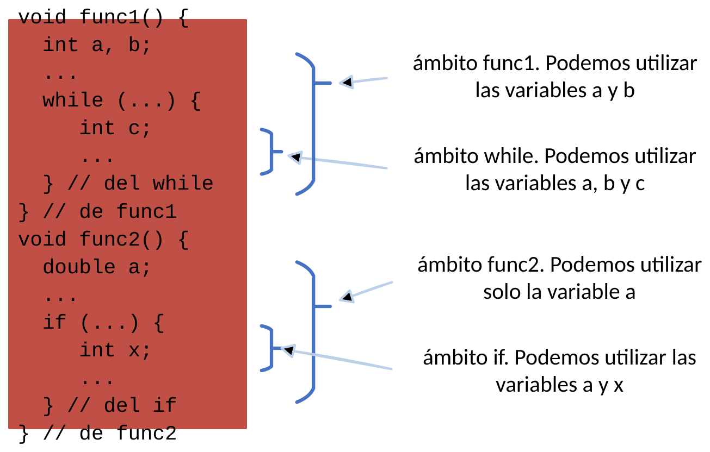

# Àmbit de les variables

L'**àmbit** (*scope*) d'una variable determina la regió del programa on la variable és accessible, visible i pot ser utilitzada. En Java, l'àmbit d'una variable està delimitat pel parell de claus `{ ... }` dins del qual ha sigut declarada.

---

## 1. Variables locals

Tota variable declarada dins del cos d'una funció és una **variable local**.

* **Visibilitat:** Només pot utilitzar-se dins d'eixa funció específica, a partir de la línia on es declara.
* **Aïllament:** No és accessible des d'altres funcions ni des del mètode `main()`.
* **Cicle de vida:** Es crea quan la funció comença a executar-se i s'allibera de la memòria tan prompte com la funció finalitza.

!!! note "Noms repetits en funcions diferents"
    Dues funcions diferents poden declarar variables amb el mateix nom (per exemple, una variable `int a;` a `func1()` i una altra `int a;` a `func2()`). Com que pertanyen a àmbits completament independents, no hi ha cap conflicte ni col·lisió.

---

## 2. Variables de bloc

Dins del cos d'una funció és habitual fer ús d'estructures de control (`if`, `for`, `while`) que obrin nous blocs delimitats per claus `{ ... }`.

Les variables declarades dins d'aquests blocs es denominen **variables de bloc**:

* Només són visibles dins del bloc que les conté (i dels seus subblocs anidats).
* Fora del bloc (per exemple, en eixir del bucle o del condicional), la variable deixa d'existir.

```java
void exemple() {
    int x = 10; // Variable local a 'exemple'
    
    if (x > 5) {
        int y = 20; // Variable de bloc (només visible dins d'aquest if)
        IO.println(x + y); // Correcte: 'x' i 'y' són visibles
    }
    
    // IO.println(y); // ERROR de compilació: 'y' no existeix fora del 'if'
}
```

!!! warning "Regla d'ombra i col·lisió de noms"
    Dins d'un bloc no es pot tornar a declarar una variable amb el mateix identificador d'una altra ja declarada en un bloc superior de la mateixa funció:
    ```java
    int a = 10;
    while (a > 0) {
        // int a = 5; // ERROR: 'a' ja està definida en l'àmbit superior
        a--;
    }
    ```

---

## 3. Representació gràfica d'àmbits

Observem el següent exemple on s'il·lustra l'abast de diferents variables segons el bloc on es declaren:

```java
void func1() {
    int a, b;
    // Àmbit de func1: podem utilitzar 'a' i 'b'
    while (...) {
        int c;
        // Àmbit del while: podem utilitzar 'a', 'b' i 'c'
    } // Fi de l'àmbit del while ('c' s'elimina de la memòria)
} // Fi de func1 ('a' i 'b' s'eliminen)

void func2() {
    double a;
    // Àmbit de func2: podem utilitzar 'a' (independent de la 'a' de func1)
    if (...) {
        int x;
        // Àmbit de l'if: podem utilitzar 'a' i 'x'
    } // Fi de l'if ('x' s'elimina)
} // Fi de func2 ('a' s'elimina)
```

{ style="display: block; margin: 1.5em auto; max-width: 450px; width: 100%; border-radius: 4px;" }

---

## 4. Recomanacions i errors freqüents

A l'hora d'organitzar les variables dins d'una funció, convé seguir aquestes pautes clares per a evitar errors de compilació:

1. **Declarar les variables de treball a l'inici de la funció:** És molt recomanable declarar les variables que emmagatzemaran resultats o dades d'ús general al principi del cos de la funció. Així s'assegura que estan disponibles en qualsevol punt posterior (inclosos els blocs condicionals i el `return`).
2. **Comptadors en la capçalera del bucle:** L'excepció natural són els índexs o comptadors de bucle, que és idoni declarar en la pròpia capçalera: `for (int i = 0; i < 10; i++)`, ja que la seua missió és purament controlar les iteracions i no es necessiten fora del bucle.
3. **Àmbit reduït i gestió de memòria (*Garbage Collector*):** Com a concepte avançat d'eficiència, en programes que gestionen estructures de dades pesades o objectes en memòria dinàmica, restringir l'àmbit d'una variable a un bloc permet que el recol·lector de fem (*Garbage Collector*) de Java en puga alliberar la memòria més prompte. Tanmateix, per a tipus bàsics i en aquest punt de l'aprenentatge, cal prioritzar sempre la claredat i correcció del codi per damunt de microoptimitzacions prematures que puguen induir a errors d'abast.

!!! danger "Error típic: Declarar variables de resultat dins d'un bloc condicional"
    Un dels errors més habituals en començar a programar és declarar una variable dins d'un bloc `if-else` amb la intenció d'utilitzar-la després:

    === "Codi erroni (error de compilació)"

        ```java
        void avaluaNota(double nota) {
            if (nota >= 5.0) {
                String estat = "Aprovat"; // Només existeix dins d'aquest bloc!
            } else {
                String estat = "Suspès";  // Només existeix dins d'aquest bloc!
            }

            IO.println("Resultat: " + estat); // ERROR: 'estat' no és visible fora de l'if!
        }
        ```

    === "Codi correcte (declaració a l'inici)"

        ```java
        void avaluaNota(double nota) {
            String estat; // Declarada a l'àmbit de la funció
            
            if (nota >= 5.0) {
                estat = "Aprovat";
            } else {
                estat = "Suspès";
            }

            IO.println("Resultat: " + estat); // Correcte: 'estat' és visible i accessible
        }
        ```
