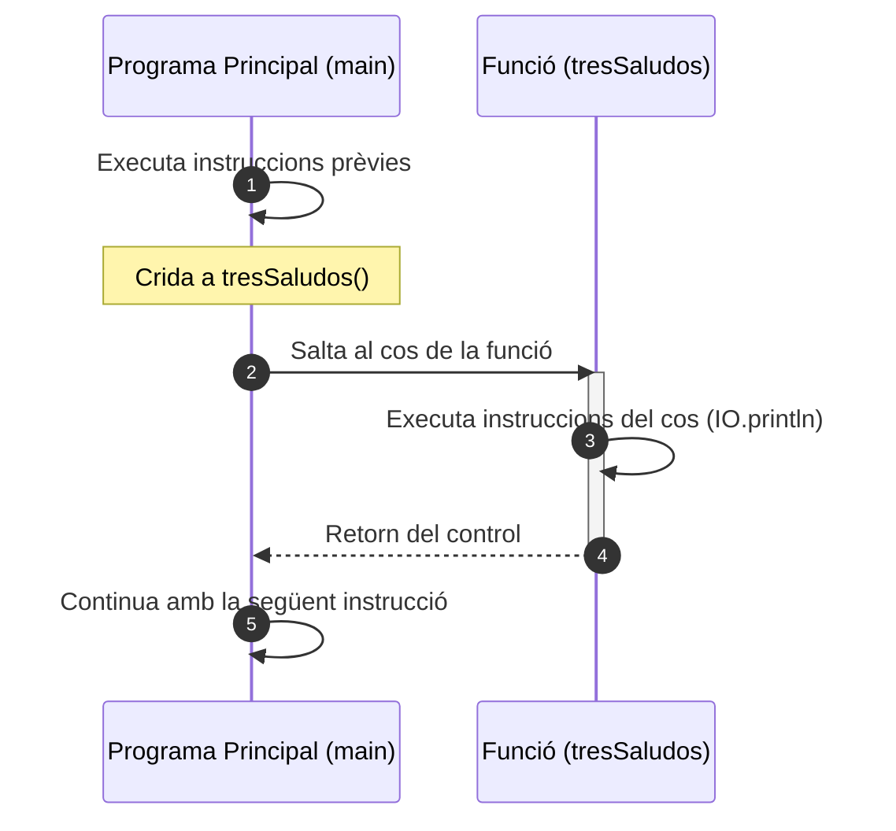
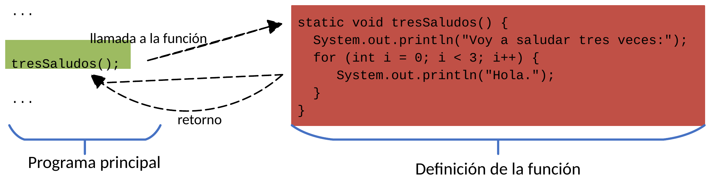

# Conceptes bàsics

La solució quan necessitem la mateixa funcionalitat en diferents llocs del nostre codi consisteix a **etiquetar amb un nom** un fragment d'instruccions i substituir en el programa aquest fragment, allà on es necessite, pel nom que li hem assignat.

Gràcies a l'ús de fitxers compactes (*compact files*) en les versions modernes de Java, podem escriure directament les nostres funcions juntament amb el mètode `void main()`, utilitzant el mòdul **`IO`** per a una entrada i eixida neta i directa.

---

## 1. Motivació: Evitar la duplicitat

Imaginem un programa on necessitem saludar tres vegades en diferents punts de l'execució:

=== "Codi repetitiu (sense funcions)"

    ```java
    void main() {
        // ... codi inicial
        
        // Fragment repetit 1
        IO.println("Vaig a saludar tres vegades:");
        for (int i = 0; i < 3; i++) {
            IO.println("Hola.");
        }
        
        // ... més codi
        
        // Fragment repetit 2
        IO.println("Vaig a saludar tres vegades:");
        for (int i = 0; i < 3; i++) {
            IO.println("Hola.");
        }
        
        // ... altre codi
        
        // Fragment repetit 3
        IO.println("Vaig a saludar tres vegades:");
        for (int i = 0; i < 3; i++) {
            IO.println("Hola.");
        }
        
        // ... resta del codi
    }
    ```

=== "Codi modular (amb funció)"

    ```java
    // Definició de la funció
    void tresSaludos() {
        IO.println("Vaig a saludar tres vegades:");
        for (int i = 0; i < 3; i++) {
            IO.println("Hola.");
        }
    }

    void main() {
        // ... codi inicial
        
        tresSaludos(); // Primera crida a la funció
        
        // ... més codi
        
        tresSaludos(); // Segona crida a la funció
        
        // ... altre codi
        
        tresSaludos(); // Tercera crida a la funció
        
        // ... resta del codi
    }
    ```

Amb aquest disseny, si demà volem canviar el text de la salutació o imprimir en majúscules, només caldrà modificar una única línia dins de `tresSaludos()`.

---

## 2. Definició i sintaxi d'una funció en Java

Una **funció** és un conjunt d'instruccions agrupades sota un identificador (nom) i amb un objectiu comú, que s'executa quan és invocada.

Dins d'un fitxer compacte, la sintaxi per a definir una funció és:

```java
tipus nomFuncio(paràmetres) {
    // Cos de la funció: bloc d'instruccions
}
```

* **`tipus`**: Indica el tipus de dada que retornarà la funció (`int`, `double`, `boolean`...). Si la funció només executa accions i no retorna cap valor, s'utilitza la paraula reservada **`void`**.
* **`nomFuncio`**: És l'identificador de la funció. Per convenció s'utilitza la nomenclatura **camelCase** (comença en minúscula i cada paraula composta comença en majúscula). Exemples: `tresSaludos()`, `calculaArrelQuadrada()`, `mostraDadesClient()`.
* **`paràmetres`**: Llista de dades que rep la funció per a operar (si no en necessita, es deixen els parèntesis buits `()`).
* **Cos de la funció**: És el bloc d'instruccions delimitat entre claus `{ ... }` que realitza la tasca de la funció.

La definició d'una funció pot situar-se abans o després del `void main()`, dins del mateix fitxer. En la pràctica és molt habitual i recomanable definir-les **abans del `void main()`** per tal que totes les funcions estiguen declarades prèviament a la seua invocació, seguint l'estil clàssic de llenguatges com C.

---

## 3. Elements clau d'una funció

| Concepte | Descripció | Exemple |
| :--- | :--- | :--- |
| **Crida o invocació** | És el nom de la funció seguit de parèntesis `()`. Actua com una nova instrucció que executa el bloc. | `tresSaludos();` |
| **Prototip o signatura** | És la declaració de la funció on s'especifica el tipus retornat, el nom i els paràmetres d'entrada. | `void tresSaludos()` |
| **Cos de la funció** | El conjunt d'instruccions contingudes entre claus que s'executen en cada crida. | `{ IO.println(...); }` |
| **Definició** | La combinació completa del prototip i el cos de la funció. | `void tresSaludos() { ... }` |

---

## 4. Flux d'execució d'una crida

Quan el programa s'executa i troba la invocació d'una funció, el flux de control segueix aquesta seqüència:

1. Les instruccions del programa principal s'executen seqüencialment fins a trobar la crida `tresSaludos();`.
2. L'execució es pausa al programa principal i el control **salta** a la primera línia de la definició de la funció.
3. S'executen cadascuna de les instruccions del cos de la funció.
4. En acabar l'última sentència del cos (o en trobar un `return`), el control **retorna** al punt exacte del programa on es va realitzar la invocació.
5. El programa principal reprèn la seua execució amb la següent instrucció.



{ style="display: block; margin: 1.5em auto; max-width: 600px; width: 100%; border-radius: 4px;" }

---

## 5. Funció vs Mètode

En informàtica, conceptualment una funció i un mètode representen el mateix concepte: un bloc de codi reutilitzable amb nom. La diferència rau en el **paradigma de programació**:

* En la **programació estructurada o procedimental** s'anomenen habitualment **funcions** o procediments.
* En la **programació orientada a objectes (POO)** s'anomenen **mètodes**, ja que formen part del comportament associat a una classe o a un objecte.
