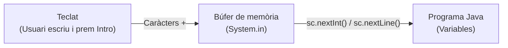

# Entrada i eixida clàssica: System.out, Scanner i formatat

Fins ara, en les primeres unitats hem utilitzat la classe simplificada **`IO`** (introduïda en Java 25 per a facilitar l'aprenentatge inicial en programes sense classe explícita mitjançant `IO.print()`, `IO.println()` i `IO.readln()`).

No obstant això, en el desenvolupament professional en Java, en projectes reals empresarials i en la gran majoria de biblioteques i codi existent, la interacció amb la consola es realitza mitjançant els mecanismes estàndard de la plataforma:

1. **`System.out` / `System.err`**: Per a l'eixida de dades per pantalla i missatges d'error.
2. **`java.util.Scanner`**: Per a l'entrada i processament de dades des del teclat.
3. **`System.out.printf()`**: Per a controlar el format exacte amb què es mostren les dades per pantalla (nombre de decimals, amplària de columnes, alineació, etc.).

---

## 1. Eixida estàndard per consola: `System.out` i `System.err`

La classe **`System`** pertany al paquet fonamental `java.lang` (que s'importa de manera automàtica en tots els fitxers Java). Dins d'aquesta classe trobem tres atributs estàtics que representen els fluxos (*streams*) estàndard del sistema:

* **`System.out`**: Flux d'eixida estàndard (*Standard Output*), connectat a la pantalla o consola. És un objecte de la classe `java.io.PrintStream`.
* **`System.err`**: Flux d'eixida d'errors (*Standard Error*), destinat a missatges d'error o diagnòstic. Sovint els entorns de desenvolupament (com IntelliJ IDEA o Eclipse) el ressalten en color roig.
* **`System.in`**: Flux d'entrada estàndard (*Standard Input*), connectat al teclat.

### Mètodes bàsics d'impressió

| Mètode | Descripció | Exemple |
| :--- | :--- | :--- |
| **`System.out.print(...)`** | Imprimeix la dada **sense** afegir cap salt de línia al final. El cursor es queda a la mateixa línia. Ideal per a demanar dades a l'usuari (*prompts*). | `System.out.print("Introdueix l'edat: ");` |
| **`System.out.println(...)`** | Imprimeix la dada i afig automàticament un **salt de línia** (`\n`) al final. | `System.out.println("Operació completada.");` |
| **`System.out.println()`** | Buit: genera únicament un salt de línia en blanc. | `System.out.println();` |
| **`System.err.println(...)`** | Imprimeix per la consola d'errors amb salt de línia. | `System.err.println("Error: valor no vàlid!");` |

!!! note "Sobrecàrrega en `PrintStream`"
    Tant `print()` com `println()` estan sobrecarregats per a admetre qualsevol tipus de dada primitiu (`int`, `double`, `boolean`, `char`), cadenes `String` o qualsevol objecte. A més, podem utilitzar l'operador de concatenació `+` per a unir cadenes i variables abans d'imprimir:
    ```java
    int edat = 20;
    System.out.println("Tens " + edat + " anys.");
    ```

---

## 2. Formatat de l'eixida: `System.out.printf`

Quan mostrem números decimals de tipus `double` o `float`, Java sol imprimir un nombre excessiu o imprecís de xifres decimals degut a la representació interna dels nombres en coma flotant:

```java
double preu = 19.99;
double iva = preu * 0.21;
System.out.println("IVA: " + iva); // Mostra: IVA: 4.197900000000001
```

Per a controlar amb exactitud quants decimals volem mostrar, com alinear les dades en columnes o com farcir amb zeros, disposem del mètode **`System.out.printf(...)`**:

```java
System.out.printf("Plantilla de format amb especificadors", valor1, valor2, ...);
```

### Sintaxi dels especificadors de format

Cada dada que volem incrustar en el text se substitueix per un **especificador de format** que comença pel caràcter `%`:

```text
%[indicadors][amplària][.precisió]conversió
```

#### Caràcters de conversió bàsics

| Especificador | Tipus de dada associat | Exemple d'ús |
| :--- | :--- | :--- |
| **`%d`** | Nombres enters (`byte`, `short`, `int`, `long`). | `System.out.printf("Edat: %d\n", 25);` |
| **`%f`** | Nombres reals de coma flotant (`float`, `double`). | `System.out.printf("Preu: %f\n", 19.99);` |
| **`%s`** | Cadenes de text (`String`). | `System.out.printf("Nom: %s\n", "Anna");` |
| **`%c`** | Caràcter individual (`char`). | `System.out.printf("Lletra: %c\n", 'A');` |
| **`%b`** | Valors booleans (`boolean`). | `System.out.printf("Actiu: %b\n", true);` |

!!! warning "Compte amb `printf` i els salts de línia"
    A diferència de `println()`, **`printf()` NO afig automàticament un salt de línia** en acabar la impressió. Si volem canviar de línia, hem d'incloure explícitament el caràcter de salt de línia **`\n`** dins de la cadena de format.

---

### Control de decimals en valors `double` (precisió)

Per a limitar el nombre de decimals mostrats per pantalla, afegim un punt seguit del nombre de decimals desitjats davant de la lletra `f` (`.precisió`):

| Especificador | Descripció | Exemple | Eixida per pantalla |
| :--- | :--- | :--- | :--- |
| **`%.2f`** | 2 decimals amb arredoniment automàtic | `System.out.printf("%.2f", 4.1979);` | `4.20` (o `4,20`) |
| **`%.1f`** | 1 sol decimal | `System.out.printf("%.1f", 4.1979);` | `4.2` |
| **`%.3f`** | 3 decimals | `System.out.printf("%.3f", Math.PI);` | `3.142` |
| **`%.0f`** | Sense decimals (arredonit a enter) | `System.out.printf("%.0f", 4.75);` | `5` |

```java
double pi = Math.PI; // 3.141592653589793
double salari = 1580.456;

System.out.printf("Pi amb 2 decimals: %.2f\n", pi);      // 3.14
System.out.printf("Pi amb 4 decimals: %.4f\n", pi);      // 3.1416
System.out.printf("Salari arredonit: %.2f €\n", salari); // 1580.46 €
```

!!! tip "Arredoniment automàtic de `printf`"
    L'especificador de precisió no trunca el número, sinó que realitza un **arredoniment matemàtic estàndard**: si el dígit següent és ≥ 5, incrementa l'últim dígit en una unitat (per exemple, `4.1979` amb `%.2f` esdevé `4.20`).

---

### Control d'amplària, alineació i ompliment de zeros

Podem afegir modificadors abans del tipus per a controlar l'espai que ocupa cada dada:

* **Amplària mínima (`%Nd` o `%Ns`):** Reserva un espai mínim de *N* caràcters. Si el text o número és més curt, s'afigen espais en blanc a l'esquerra (alineació per defecte a la **dreta**).
* **Alineació a l'esquerra (`%-Nd` o `%-Ns`):** Si afegim el signe menys `-`, els espais en blanc s'afigen al final, alineant la dada a l'**esquerra**.
* **ompliment amb zeros (`%0Nd`):** Si col·loquem un `0` davant d'un enter, els espais buits s'omplin amb zeros en compte d'espais (molt útil per a hores, minuts, dates o codis).
* **Amplària total en decimals (`%N.Pf`):** En un `double`, el primer número *N* indica l'**amplària TOTAL** de tot el camp (incloent dígits enters, el punt decimal, els decimals i els espais en blanc inicials).

#### Exemples visuals pas a pas

Envoltem els exemples entre claudàtors `[...]` per a veure amb claredat com funcionen els espais reservats:

```java
int num = 42;

// Amplària mínima de 5 (alineat a la dreta per defecte): 3 espais + 2 dígits
System.out.printf("[%5d]\n", num);    // Mostra: [   42]

// Alineació a l'esquerra amb '-': 2 dígits + 3 espais
System.out.printf("[%-5d]\n", num);   // Mostra: [42   ]

// ompliment amb zeros amb '0': 3 zeros + 2 dígits
System.out.printf("[%05d]\n", num);   // Mostra: [00042]

// Amplària total de 8 caràcters amb 2 decimals (4 espais + "3.50")
double preu = 3.5;
System.out.printf("[%8.2f]\n", preu); // Mostra: [    3.50]
```

#### Exemple pràctic 1: Format d'hora (rellotge digital)

```java
int hores = 9;
int minuts = 5;
System.out.printf("Hora: %02d:%02d\n", hores, minuts); // Mostra: Hora: 09:05
```

#### Exemple pràctic 2: Maquetació d'una taula alineada en columnes

Combinant aquests modificadors podem alinear taules de dades de forma mil·limètrica:

```java
// Columnes:
// 1. PRODUCTE: text alineat a l'esquerra de 15 caràcters (%-15s)
// 2. UNITATS:  enter alineat a la dreta de 8 caràcters (%8d)
// 3. PREU (€): decimal de 10 caràcters d'amplada total amb 2 decimals (%10.2f)

System.out.printf("%-15s %8s %10s\n", "PRODUCTE", "UNITATS", "PREU (€)");
System.out.println("------------------------------------");
System.out.printf("%-15s %8d %10.2f\n", "Poma Golden", 3, 1.85);
System.out.printf("%-15s %8d %10.2f\n", "Llet sencera", 12, 11.40);
System.out.printf("%-15s %8d %10.2f\n", "Xocolata pura", 2, 4.50);
```

**Eixida generada per la taula:**
```text
PRODUCTE         UNITATS   PREU (€)
------------------------------------
Poma Golden            3       1.85
Llet sencera          12      11.40
Xocolata pura          2       4.50
```

---

### Configuració regional (*Locale*): Coma o punt decimal?

Segons la configuració del vostre sistema operatiu, els nombres decimals es mostraran per defecte amb un **punt** (com `3.14`, habitual en l'àmbit anglosaxó) o amb una **coma** (com `3,14`, habitual a Espanya).

Si volem forçar que `printf` utilitze sempre la **coma**, podem indicar la configuració en espanyol mitjançant `Locale.of("es", "ES")` com a primer paràmetre:

```java
import java.util.Locale;

double valor = 12.345;
System.out.printf(Locale.of("es", "ES"), "Valor amb coma: %.2f\n", valor); // Mostra: 12,35
```

---

## 3. Entrada estàndard per consola: La classe `java.util.Scanner`

La classe **`Scanner`** es troba disponible des de Java 5 en el paquet `java.util`. S'encarrega de llegir fluxos de text (provinents del teclat, d'arxius o de cadenes) i fragmentar-los en xicotetes unitats anomenades **testimonis** (*tokens*), separats habitualment per caràcters en blanc (espais, tabuladors i salts de línia).

### Passos per a utilitzar `Scanner`

1. **Importar la classe:** Cal incloure la instrucció a l'inici del fitxer:
   ```java
   import java.util.Scanner;
   ```
2. **Crear l'objecte associat al teclat (`System.in`):**
   ```java
   Scanner sc = new Scanner(System.in);
   ```
3. **Cridar als mètodes de lectura segons el tipus de dada desitjat:**
   ```java
   int edat = sc.nextInt();
   ```
4. **Tancar l'escàner en finalitzar (bona pràctica):**
   ```java
   sc.close();
   ```

---

### Principals mètodes de lectura de `Scanner`

| Mètode | Descripció | Exemple |
| :--- | :--- | :--- |
| **`sc.nextInt()`** | Llig el següent valor enter com a `int`. | `int n = sc.nextInt();` |
| **`sc.nextDouble()`** | Llig el següent valor real com a `double`. | `double r = sc.nextDouble();` |
| **`sc.nextLong()`** | Llig un enter de tipus `long`. | `long p = sc.nextLong();` |
| **`sc.nextBoolean()`** | Llig un booleà (`true` o `false`). | `boolean b = sc.nextBoolean();` |
| **`sc.next()`** | Llig una **única paraula** (ignora espais inicials i llig fins al següent espai en blanc o salt de línia). | `String paraula = sc.next();` |
| **`sc.nextLine()`** | Llig tota la **línia sencera** fins a trobar el caràcter de salt de línia (`\n`). | `String nomComplet = sc.nextLine();` |

!!! tip "Com llegir un caràcter individual (`char`) amb `Scanner`?"
    Com que `Scanner` no disposa d'un mètode `nextChar()`, per a obtindre un caràcter llegim el text amb `next()` (o `nextLine()`) i n'extraiem el primer caràcter situat a la posició 0 mitjançant el mètode **`.charAt(0)`**:
    ```java
    System.out.print("Introdueix una opció (S/N): ");
    char resposta = sc.next().charAt(0);
    ```

---

### El separador decimal en `Scanner`: Coma (,) o punt (.)?

De la mateixa manera, quan introduïm un número decimal per teclat amb `sc.nextDouble()`:

* Depenent de la configuració de l'ordinador, `Scanner` pot demanar el decimal amb un **punt** (`3.14`) o amb una **coma** (`3,14`).
* Si el vostre sistema espera una cosa i en teclegem una altra, el programa llançarà un error (`InputMismatchException`).

#### Com forçar que accepte sempre la coma (,)?

Per a assegurar-nos que `Scanner` accepte sempre la **coma** (el format estàndard a Espanya), podem indicar la configuració regional en espanyol mitjançant `Locale.of("es", "ES")`:

```java
import java.util.Locale;
import java.util.Scanner;

Scanner sc = new Scanner(System.in);
sc.useLocale(Locale.of("es", "ES")); // Ara sc.nextDouble() accepta sempre 3,14 amb coma!
```

!!! tip "Forçar la coma en tot el programa"
    Si voleu que tant `Scanner` com `printf` utilitzen sempre la coma sense haver de configurar-los per separat, podeu afegir aquesta línia a l'inici del vostre programa:
    ```java
    Locale.setDefault(Locale.of("es", "ES"));
    ```

---

## 4. El funcionament intern del búfer i el problema clàssic del salt de línia

Per a entendre com evitar els errors més comuns amb `Scanner`, és imprescindible conéixer com funciona internament la lectura des del teclat:



1. Quan l'usuari escriu per teclat i prem la tecla **Intro**, tots els caràcters teclejats —inclòs el caràcter invisible de retorn o salt de línia **`\n`**— s'emmagatzemen temporalment en una zona de memòria anomenada **búfer d'entrada**.
2. Els mètodes que llegeixen valors numèrics o paraules (`nextInt()`, `nextDouble()`, `next()`, etc.) **només consumeixen els caràcters de la dada** i s'aturen just davant del primer delimitador. Això vol dir que el caràcter de salt de línia **`\n` es queda abandonat dins del búfer**.
3. Si a continuació invoquem **`nextLine()`**, aquest mètode està dissenyat per a consumir tot el contingut fins a trobar un salt de línia. Com que troba immediatament el `\n` que havia quedat penjat del número anterior, **el consumeix al moment i retorna una cadena buida (`""`)**, sense esperar mai que l'usuari puga escriure res!

### Exemple de l'error típic

```java
Scanner sc = new Scanner(System.in);

System.out.print("Introdueix la teua edat: ");
int edat = sc.nextInt(); // L'usuari escriu 25 i prem Intro

System.out.print("Introdueix la teua adreça: ");
String adreca = sc.nextLine(); // EL PROGRAMA NO S'ATURA! Llig directament el \n pendent!

System.out.println("Edat: " + edat);
System.out.println("Adreça: '" + adreca + "'"); // Queda buida: ''
```

---

### Com solucionar el problema del búfer?

Disposem de dues estratègies per a resoldre aquesta situació:

#### Estratègia 1: Netejar el búfer manualment amb un `nextLine()` de descart

Consisteix a col·locar una instrucció buida `sc.nextLine();` just després de llegir un número i abans de llegir qualsevol línia de text:

```java
System.out.print("Introdueix la teua edat: ");
int edat = sc.nextInt(); // Llig l'enter

sc.nextLine(); // NETEJA EL BÚFER: consumeix el \n pendent

System.out.print("Introdueix la teua adreça: ");
String adreca = sc.nextLine(); // Ara sí s'atura correctament a esperar el text!
```

#### Estratègia 2: Llegir sempre amb `nextLine()` i convertir (Mètode recomanat)

En compte de mesclar `nextInt()` i `nextLine()`, podem llegir **sempre** línies completes com a text (`sc.nextLine()`) i transformar el text al tipus numèric necessari mitjançant els mètodes de conversió estàtics de Java (`Integer.parseInt()`, `Double.parseDouble()`), exactament com fèiem amb `IO.readln()`:

```java
System.out.print("Introdueix la teua edat: ");
int edat = Integer.parseInt(sc.nextLine()); // Llig tota la línia i no deixa residus al búfer!

System.out.print("Introdueix el teu pes: ");
double pes = Double.parseDouble(sc.nextLine());

System.out.print("Introdueix la teua adreça: ");
String adreca = sc.nextLine(); // Funciona perfectament sense problemes!
```

!!! tip "Per què aquesta és l'estratègia preferida en l'entorn professional?"
    Llegir sempre línies senceres amb `sc.nextLine()` i convertir amb `Integer.parseInt()` o `Double.parseDouble()` és una pràctica molt recomanable perquè evita errors subtils de memòria cau, simplifica el control de flux i permet afegir blocs de validació i gestió d'errors de forma més neta.

---


## 5. Taula comparativa: Classe `IO` (Java 25) vs Model Clàssic

| Operació | Amb la classe `IO` (Java 25) | Model Clàssic (`System.out` / `Scanner`) |
| :--- | :--- | :--- |
| **Imprimir sense salt de línia** | `IO.print("Text");` | `System.out.print("Text");` |
| **Imprimir amb salt de línia** | `IO.println("Text");` | `System.out.println("Text");` |
| **Imprimir amb format** | *No disposa de format directe* | `System.out.printf("%.2f\n", valor);` |
| **Imprimir errors** | `IO.println("Error...");` | `System.err.println("Error...");` |
| **Llegir una línia de text** | `String s = IO.readln();` | `String s = sc.nextLine();` |
| **Llegir un número enter** | `int n = Integer.parseInt(IO.readln());` | `int n = sc.nextInt();`<br>*(o `Integer.parseInt(sc.nextLine())`)* |
| **Llegir un número decimal** | `double d = Double.parseDouble(IO.readln());` | `double d = sc.nextDouble();`<br>*(o `Double.parseDouble(sc.nextLine())`)* |
| **Llegir un caràcter** | `char c = IO.readln().charAt(0);` | `char c = sc.next().charAt(0);` |
| **Preparació prèvia** | Cap (automàtic en Java 25) | `import java.util.Scanner;`<br>`Scanner sc = new Scanner(System.in);` |
