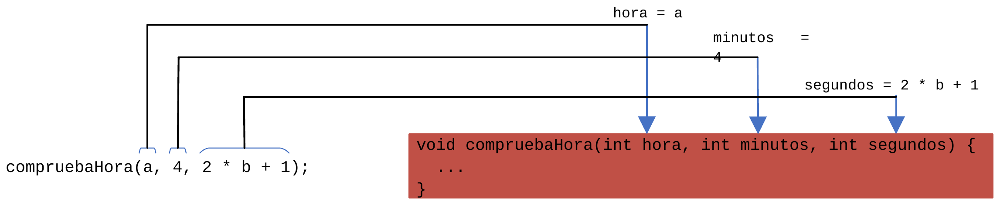
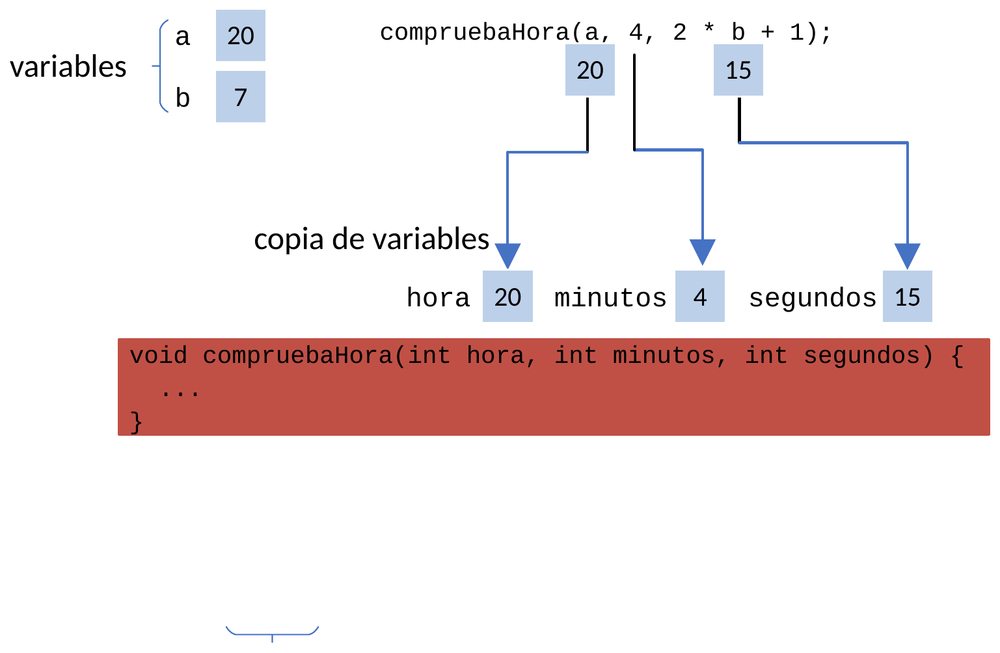

# Pas d'informació a una funció

En moltes ocasions, una funció necessita rebre informació externa per a dur a terme la seua tasca. Si només poguérem definir funcions sense paràmetres, hauríem de crear una funció diferent per a cada situació particular: `unSaludo()`, `dosSaludos()`, `tresSaludos()`...

La solució òptima és dissenyar funcions amb **paràmetres**, de manera que una única funció `varisSaludos(int vegades)` puga saludar tantes vegades com siga necessari segons el valor que li passem.

---

## 1. Paràmetres formals vs Arguments en la crida

Convé distingir clarament entre dos conceptes:

* **Paràmetres formals:** Són les variables que es declaren en la capçalera (prototip) de la funció. Actuen com a variables locals inicialitzades en el moment de la invocació.
* **Arguments o valors en la crida:** Són els valors reals que es passen entre parèntesis en invocar la funció des d'un altre punt del programa.

```java
// 'vegades' és el paràmetre formal (de tipus int)
void varisSaludos(int vegades) {
    for (int i = 0; i < vegades; i++) {
        IO.println("Hola.");
    }
}
```

En la crida a una funció podem utilitzar com a arguments:
* **Literals:** `varisSaludos(2);`
* **Variables:** `int n = 3; varisSaludos(n);`
* **Expressions:** `varisSaludos(2 * n + 1);`

---

## 2. Declaració de paràmetres múltiples

Una funció pot rebre tants paràmetres com necessite, separats per comes:

```java
tipus nomFuncio(tipus1 param1, tipus2 param2, ..., tipusN paramN) {
    // Cos de la funció
}
```

Per exemple, una funció que comprove si una hora, minuts i segons són vàlids tindria el prototip:

```java
void comprovaHora(int hora, int minuts, int segons)
```

En realitzar la crida:

```java
int a = 20, b = 7;
comprovaHora(a, 4, 2 * b + 1);
```

{ style="display: block; margin: 1.5em auto; max-width: 600px; width: 100%; border-radius: 4px;" }

* El valor d'`a` (20) s'assigna al paràmetre `hora`.
* El literal `4` s'assigna al paràmetre `minuts`.
* El resultat de l'expressió `2 * b + 1` (15) s'assigna al paràmetre `segons`.

---

## 3. Pas per valor (o per còpia) en Java

!!! important "Regla d'or de Java: Sempre és pas per valor"
    En el llenguatge de programació Java, **tots els paràmetres es passen sempre per valor (o per còpia)**. Això significa que la funció rep una còpia exacta del valor que conté la variable en el moment de la crida, mai la variable original.

Observem com es distribueixen les variables en memòria:

{ style="display: block; margin: 1.5em auto; max-width: 450px; width: 100%; border-radius: 4px;" }

### Implicació fonamental

Com que la funció treballa sobre una **còpia** independent:

> **Qualsevol modificació realitzada sobre un paràmetre dins del cos d'una funció NO afecta de cap manera a la variable original utilitzada en la crida.**

Vegem un exemple clar dins d'un fitxer compacte:

```java
void modificaValor(int numero) {
    IO.println("Dins de la funció (abans): " + numero); // Mostra 10
    numero = 99; // Modifiquem la còpia local
    IO.println("Dins de la funció (després): " + numero); // Mostra 99
}

void main() {
    int edat = 10;
    IO.println("Al main (abans): " + edat); // Mostra 10
    
    modificaValor(edat); // Passem 'edat' per valor
    
    IO.println("Al main (després): " + edat); // Continua valent 10!
}
```

La variable `edat` del programa principal roman inalterada (`10`).
