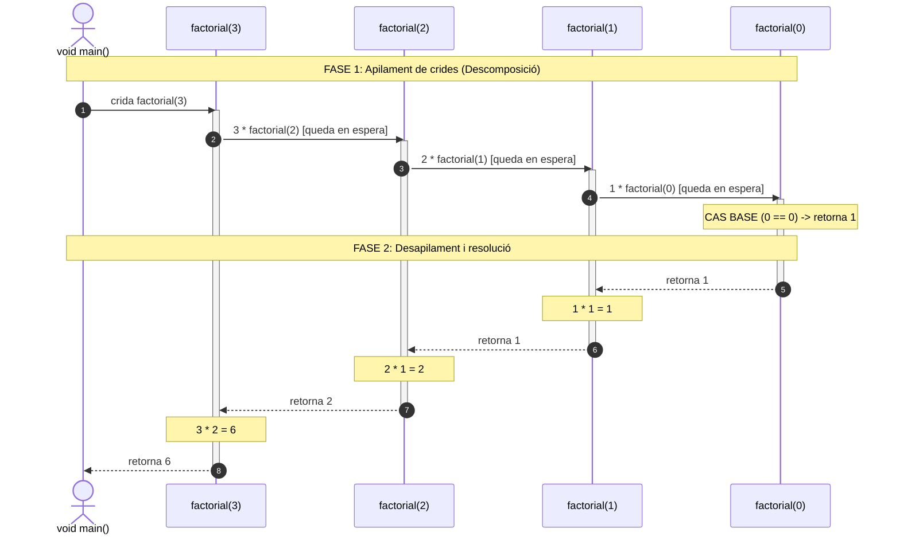

# Recursivitat

Una funció pot ser invocada des de qualsevol punt del programa: des del mètode principal `void main()`, des d'una altra funció i fins i tot **des de dins del seu propi cos d'instruccions**. Quan una funció s'invoca a si mateixa, diem que és una **funció recursiva**.

---

## 1. Concepte i esquema general

La idea essencial darrere de la recursivitat és resoldre un problema complex dividint-lo en instàncies més menudes d'aquest mateix problema, fins a arribar a una mida tan reduïda que la solució siga trivial.

Tota funció recursiva **ben dissenyada** ha de comptar obligatòriament amb dos elements:

1. **Cas base (*base case*):** Una condició (habitualment un `if`) que deté la cadena de crides recursives i retorna una resposta directa i immediata.
2. **Cas recursiu (*recursive case*):** La crida a la mateixa funció, amb paràmetres que **convergisquen cap al cas base**.

```java
int funcioRecursiva(int dades) {
    int resultat;
    
    if (/* cas base */) {
        resultat = valorBase; // Solució directa sense cridar de nou
    } else {
        resultat = funcioRecursiva(/* novesDades més menudes */); // Crida recursiva
    }
    
    return resultat;
}
```

!!! danger "Perill: El bucle infinit recursiu"
    Si oblidem definir el cas base o si les dades passades en la crida recursiva no s'acosten cap a ell, el programa farà infinites crides a la funció fins a omplir completament la memòria de la pila de crides (*call stack*), llançant l'excepció:  
    `java.lang.StackOverflowError`

---

## 2. Exemple clàssic: Càlcul del Factorial ($n!$)

El factorial d'un nombre enter positiu $n$ es defineix matemàticament com el producte de tots els enters des d'$1$ fins a $n$:

$$n! = n \times (n - 1) \times (n - 2) \times \ldots \times 2 \times 1$$

Per exemple: $5! = 5 \times 4 \times 3 \times 2 \times 1 = 120$.

Aquesta definició pot expressar-se de forma recursiva observant que:

$$n! = n \times (n - 1)!$$

Per definició matemàtica, el factorial de zero és u: **$0! = 1$** (aquest serà el nostre **cas base**).


### Implementació en fitxer compacte

Utilitzem el tipus `long` en comptes d'`int` perquè els factorials creixen molt ràpidament:

```java
long factorial(int n) {
    long resultat;

    if (n == 0) { // Cas base
        resultat = 1;
    } else {      // Cas recursiu
        resultat = n * factorial(n - 1);
    }

    return resultat;
}

void main() {
    int n = 4;
    IO.println("El factorial de " + n + " és: " + factorial(n));
}
```

---

## 3. Traça pas a pas i pila de crides (*Call Stack*)

Vegem amb detall què ocorre a la memòria de la Màquina Virtual de Java (JVM) quan invoquem `factorial(3)`:



1. **`factorial(3)`** comprova `3 == 0` (fals) i avalua `3 * factorial(2)`. Es pausa a l'espera del resultat.
2. Es crea en memòria una segona instància per a **`factorial(2)`**, que s'apila sobre l'anterior i avalua `2 * factorial(1)`.
3. Es crea una tercera instància per a **`factorial(1)`**, que s'apila i avalua `1 * factorial(0)`.
4. Es crea **`factorial(0)`**. Com que `0 == 0` és cert (**cas base**), retorna directament **`1`** i s'elimina de la pila.
5. **`factorial(1)`** reprèn el càlcul: `1 * 1 = 1` i retorna `1`.
6. **`factorial(2)`** reprèn: `2 * 1 = 2` i retorna `2`.
7. **`factorial(3)`** reprèn: `3 * 2 = 6` i retorna finalment **`6`** al `void main()`.

---

## 4. Recursivitat vs Iteració (Bucles)

Tot problema que puga resoldre's de forma recursiva també pot resoldre's de forma iterativa mitjançant bucles (`for`, `while`), i viceversa.

| Aspecte | Recursivitat | Iteració (Bucles) |
| :--- | :--- | :--- |
| **Estructura** | Condicional que atura la crida a si mateixa. | Bucle amb condició de finalització. |
| **Memòria** | Requereix espai a la pila (*call stack*) per a cada crida. | Memòria constant (només variables de control). |
| **Rendiment** | Major sobrecost per la creació de marcs d'execució. | Més ràpida i eficient a nivell de CPU. |
| **Claredat** | Codi molt elegant i intuïtiu per a estructures jeràrquiques (arbres, grafs, fractals). | Pot resultar més complex o extens en determinats algorismes matemàtics. |
