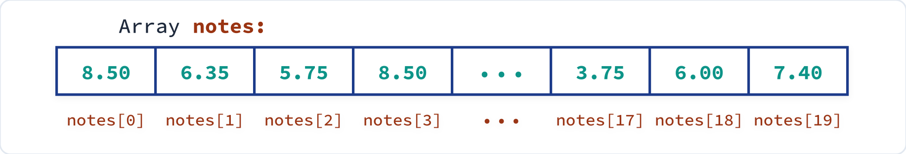
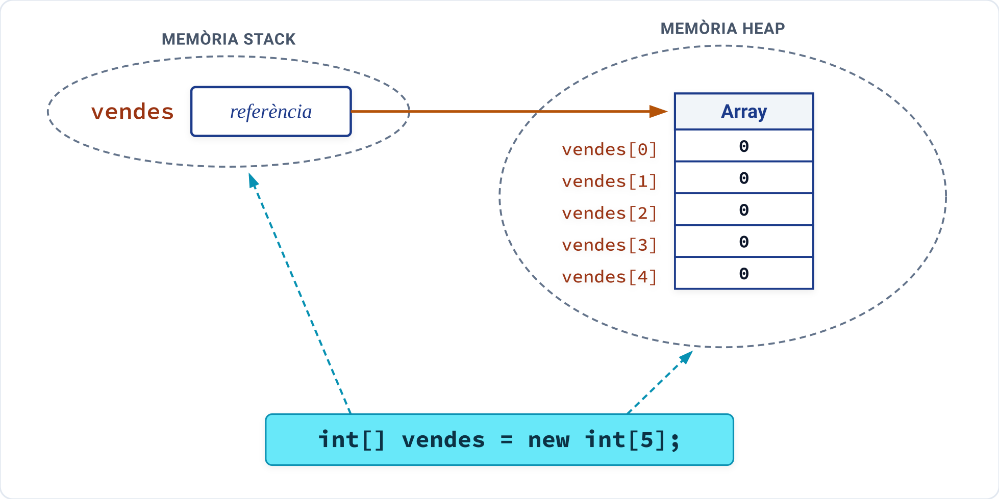
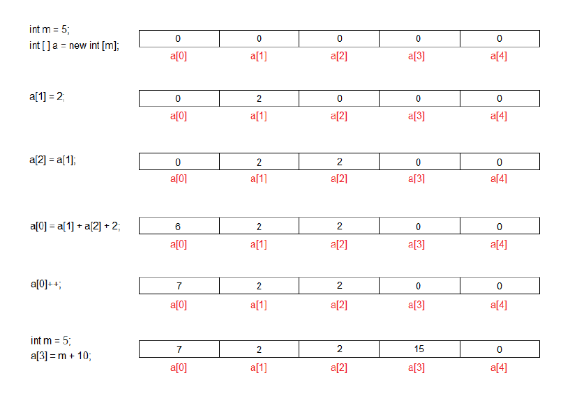

# Arrays unidimensionals en Java

Un **array** (també anomenat **vector**, **taula** o **arranjament**) és una de les estructures de dades més fonamentals en programació. Permet gestionar col·leccions d'elements sota un mateix nom de variable de manera ordenada i eficient.

---

## 1. Concepte d'array

Un array és una **col·lecció finita i homogènia de dades** que s'emmagatzemen en **posicions consecutives de memòria** i reben un nom comú:

* **Finita:** Té una grandària determinada en el moment de la seua creació i no pot créixer ni reduir-se dinàmicament durant l'execució del programa.
* **Homogènia:** Tots els elements que conté han de ser obligatòriament del **mateix tipus** de dada (tots `int`, tots `double`, tots `String`, etc.).
* **Consecutiva:** Els elements se situen físicament un darrere de l'altre en la memòria de l'ordinador.

Per a accedir a cada element individual d'un array s'utilitza el nom de l'array seguit d'un **índex** entre corxets `[ ]`. L'índex representa la posició relativa de l'element:

* El **primer element** ocupa sempre la posició o índex **`0`**.
* El segon element ocupa la posició **`1`**.
* En un array de $n$ elements, l'**últim element** ocupa la posició **`n - 1`**.

{ style="display: block; margin: 1.5em auto; max-width: 750px; width: 100%; border-radius: 4px;" }

Per exemple, si guardem les notes de 20 estudiants en un vector anomenat `notes`, `notes[0]` conté la qualificació del primer alumne i `notes[19]` la de l'últim.

---

## 2. Creació d'arrays unidimensionals

En Java, els arrays s'implementen internament com a **objectes**. Per tant, la creació d'un array requereix dues fases clarament diferenciades:

1. **Declaració:** Es defineix la variable que farà de referència a l'array.
2. **Instanciació:** Es reserva el bloc continu de memòria a l'heap mitjançant l'operador `new`.

### 2.1 Declaració d'un array

La declaració indica el tipus de dades que contindrà l'array i el seu identificador. Es pot escriure de dues formes equivalents:

```java
tipus[] nomArray; // Sintaxi estàndard i recomanada en Java
tipus nomArray[]; // Sintaxi heretada del llenguatge C/C++
```

Exemples:

```java
int[] vendes;          // Referència a un array d'enters
double[] temperatures; // Referència a un array de reals
String[] noms;         // Referència a un array de cadenes
```

!!! note "Només es crea la referència"
    En declarar la variable `int[] vendes;`, encara **no s'ha reservat memòria** per als valors. La variable conté provisionalment el valor especial `null` (no apunta a cap adreça de memòria real).

### 2.2 Instanciació d'un array

Mitjançant la instanciació es reserva un bloc continu de memòria a l'heap suficient per a albergar tots els elements. La sintaxi és:

```java
nomArray = new tipus[grandària];
```

* **`nomArray`**: És l'identificador declarat prèviament.
* **`tipus`**: Tipus de dada dels elements (ha de coincidir amb el de la declaració).
* **`grandària`**: Expressió de tipus enter positiu que especifica el nombre total d'elements. No es pot modificar un cop creat.
* **`new`**: Operador d'instanciació que assigna la memòria necessària. Si no hi ha prou memòria lliure en el sistema, es llança l'excepció `java.lang.OutOfMemoryError`.

```java
// Reserva espai per a 5 números enters i assigna l'adreça a 'vendes'
vendes = new int[5];
```

### 2.3 Declaració i instanciació en una sola instrucció

La manera més habitual i compacta de crear un array és combinar ambdós passos en una única línia:

```java
tipus[] nomArray = new tipus[grandària];
```

```java
int[] vendes = new int[5];
double[] notes = new double[30];
```

A més, la grandària de l'array no ha de ser necessàriament una constant fixa en el codi font; es pot sol·licitar a l'usuari per teclat o calcular-la durant l'execució:

```java
IO.print("Indica el nombre d'elements: ");
int numElements = Integer.parseInt(IO.readln());

int[] dades = new int[numElements]; // La grandària es defineix dinàmicament
```

### 2.4 Referència en memòria vs. Contingut

Com que els arrays són objectes, cal tindre molt present com s'emmagatzemen en memòria:

* **Variable referència (a l'Stack):** Emmagatzema únicament l'adreça de memòria on comença l'array.
* **Elements de l'array (a l'Heap):** És el bloc consecutiu on es guarden els valors reals.

{ style="display: block; margin: 1.5em auto; max-width: 550px; width: 100%; border-radius: 4px;" }

!!! warning "Còpia de referències vs. Còpia d'elements"
    Si fem `int[] b = vendes;`, **no** estem duplicant l'array! Estem fent que dues variables referencien exactament al mateix bloc de memòria. Qualsevol modificació feta mitjançant `b[0] = 99;` afectarà també a `vendes[0]`.

---

## 3. Inicialització d'arrays unidimensionals

### 3.1 Valors per defecte de Java

Quan instanciem un array amb `new`, Java inicialitza de manera automàtica cadascun dels seus elements amb un valor per defecte segons el tipus:

| Tipus de dada dels elements | Valor inicial assignat per defecte |
| :--- | :--- |
| Numèrics enters (`byte`, `short`, `int`, `long`) | `0` |
| Numèrics decimals (`float`, `double`) | `0.0` |
| Caràcters (`char`) | `'\u0000'` o `'\0'` (caràcter nul) |
| Booleans (`boolean`) | `false` |
| Objectes i cadenes (`String`, referències) | `null` |

### 3.2 Inicialització explícita (llista de valors)

Si coneixem per endavant els valors que volem emmagatzemar, podem inicialitzar l'array en el moment de la declaració indicant els elements entre claus `{ ... }` separats per comes. En aquest cas no cal utilitzar la paraula clau `new` ni indicar la grandària, ja que Java la dedueix automàticament a partir del nombre d'elements:

```java
double[] notes = {6.7, 7.5, 5.3, 8.75, 3.6, 6.5}; // Array de 6 elements double
boolean[] respostes = {true, false, true, true};   // Array de 4 elements boolean
String[] dies = {"Dilluns", "Dimarts", "Dimecres", "Dijous", 
                 "Divendres", "Dissabte", "Diumenge"}; // 7 cadenes
```

---

## 4. Accés i manipulació dels elements

Per a llegir o modificar el valor d'una posició de l'array s'utilitza l'operador índex `[ ]`:

```java
int[] valors = new int[5];

valors[0] = 10;          // Assignació d'un valor
valors[1] = valors[0] * 2; // Ús com a operand (valors[1] valdrà 20)
valors[2]++;             // Increment directe
```

Un altre exemple:

{ style="display: block; margin: 1.5em auto; max-width: 750px; width: 100%; border-radius: 4px;" }

Com a índex podem utilitzar qualsevol expressió que produïsca un nombre enter (`int`, `short`, `byte`, o una variable entera):

```java
int posicio = 3;
valors[posicio] = 50;
valors[posicio + 1] = valors[posicio] - 10;
```

### 4.1 L'atribut `.length`

Tots els arrays en Java disposen d'un atribut públic de només lectura anomenat **`length`**, que conté el nombre d'elements que componen l'array:

```java
double[] temperatures = new double[12];
IO.println("L'array té " + temperatures.length + " posicions."); // Mostra 12
```

!!! tip "Diferència entre `length` en arrays i `length()` en Strings"
    * En un **array**, `length` és un **atribut** (es posa **sense** parèntesis: `notes.length`).
    * En un **String**, `length()` és un **mètode** (es posa **amb** parèntesis: `cadena.length()`).

### 4.2 Desbordament de rang: `ArrayIndexOutOfBoundsException`

L'índex d'un array de grandària $N$ ha d'estar comprés obligatòriament entre `0` i `N - 1`. Si s'intenta accedir a una posició negativa o superior o igual a `N`:

* El compilador **no avisarà** de cap error sintàctic (ja que l'índex sovint es calcula en temps d'execució).
* En executar el programa es produirà una fallada crítica: es llança l'excepció **`java.lang.ArrayIndexOutOfBoundsException`** i el programa s'aturarà si no es captura l'error.

```java
int[] a = new int[5]; // Posicions vàlides: 0, 1, 2, 3, 4
a[5] = 100; // ERROR en execució: ArrayIndexOutOfBoundsException: Index 5 out of bounds for length 5
```

Per a evitar aquest problema, és una bona pràctica comprovar els límits abans d'accedir a una posició variable:

```java
IO.print("Introdueix una posició: ");
int i = Integer.parseInt(IO.readln());

if (i >= 0 && i < a.length) {
    IO.print("Introdueix el valor: ");
    a[i] = Integer.parseInt(IO.readln());
} else {
    IO.println("Error: la posició introduïda està fora dels límits de l'array.");
}
```

---

## 5. Recorregut d'un array unidimensional

Recórrer un array consisteix a accedir de manera sistemàtica i seqüencial a cadascun dels seus elements per a processar-los (llegir-los, modificar-los, cercar un valor o mostrar-los per pantalla).

### 5.1 Recorregut amb bucle `for` clàssic

És la manera tradicional més emprada. S'utilitza una variable entera com a comptador que comença en `0` i arriba estrictament fins a `array.length - 1`:

```java
double[] notes = {2.3, 8.5, 3.2, 9.5, 4.0, 5.5, 7.0};

// Recorregut ascendent (del primer a l'últim)
for (int i = 0; i < notes.length; i++) {
    IO.println("Nota de l'alumne " + i + ": " + notes[i]);
}

// Recorregut descendent (de l'últim al primer)
for (int i = notes.length - 1; i >= 0; i--) {
    IO.print(notes[i] + " ");
}
```

### 5.2 Recorregut amb bucle `for-each` (for millorat)

A partir de Java 5 s'incorpora la sentència `for-each`, dissenyada específicament per a iterar còmodament sobre arrays i col·leccions sense necessitat de gestionar manualment l'índex:

```java
for (tipus nomVariable : nomArray) {
    // Instruccions amb nomVariable
}
```

* **`tipus`**: Tipus de dada dels elements de l'array.
* **`nomVariable`**: Variable temporal a la qual, en cada volta del bucle, se li assigna automàticament el valor del següent element.
* **`nomArray`**: Array que volem recórrer.

```java
double[] temperatures = {18.5, 21.0, 19.4, 22.8, 17.2};

for (double temp : temperatures) {
    IO.println("Temperatura registrada: " + temp);
}
```

!!! important "Limitació fonamental del bucle `for-each`"
    El bucle `for-each` **només serveix per a consultar dades en mode lectura**. No permet modificar els elements de l'array (si assignem un valor a `temp`, només canviem la variable local temporal, no l'element original de l'array). Tampoc proporciona l'índex o posició en què ens trobem. Quan calga modificar continguts o conéixer la posició, cal utilitzar el bucle `for` clàssic.

---

## 6. Exemples resolts bàsics

A continuació veurem tres exemples complets que il·lustren operacions típiques amb vectors.

### Exemple 1: Càlcul de la mitjana i alumnes per damunt de la mitjana

Llegeix la quantitat d'alumnes d'una aula, demana la qualificació de cadascun, calcula la mitjana del grup i finalment mostra quins alumnes han superat la mitjana.

??? example "Solució en Java"
    ```java
    /*
     * Programa que llegeix les notes d'un grup d'alumnes, en calcula la mitjana
     * i mostra quins alumnes tenen qualificacions per damunt de la mitjana.
     */
    void main() {
        int numAlumnes;
        double suma = 0.0;
        double mitjana;

        do {
            IO.print("Nombre d'alumnes de la classe (> 0): ");
            numAlumnes = Integer.parseInt(IO.readln());
        } while (numAlumnes <= 0);

        // Creem l'array amb la grandària indicada
        double[] notes = new double[numAlumnes];

        // 1r Recorregut: Lectura de notes
        IO.println("\n--- Entrada de notes ---");
        for (int i = 0; i < notes.length; i++) {
            IO.print("Nota de l'alumne " + (i + 1) + ": ");
            notes[i] = Double.parseDouble(IO.readln());
        }

        // 2n Recorregut: Suma de totes les notes
        for (double nota : notes) {
            suma += nota;
        }

        mitjana = suma / notes.length;
        IO.println("\nNota mitjana del curs: " + mitjana);

        // 3r Recorregut: Filtrat d'alumnes per damunt de la mitjana
        IO.println("\nAlumnes amb nota superior a la mitjana:");
        for (int i = 0; i < notes.length; i++) {
            if (notes[i] > mitjana) {
                IO.println("Alumne núm. " + (i + 1) + " -> Nota: " + notes[i]);
            }
        }
    }
    ```

---

### Exemple 2: Inversió d'un vector d'enters

Guarda 5 enters demanats per teclat en un vector i els mostra per pantalla en ordre estrictament invers al que es van introduir.

??? example "Solució en Java"
    ```java
    /*
     * Programa que llegeix 5 números i els mostra en ordre invers.
     */
    void main() {
        final int MIDA = 5;
        int[] dades = new int[MIDA];

        IO.println("Introdueix " + MIDA + " nombres enters:");
        for (int i = 0; i < dades.length; i++) {
            IO.print("Element [" + i + "]: ");
            dades[i] = Integer.parseInt(IO.readln());
        }

        IO.println("\nNombres en ordre invers:");
        for (int i = dades.length - 1; i >= 0; i--) {
            IO.print(dades[i] + " ");
        }
        IO.println();
    }
    ```

---

### Exemple 3: Comptador i mitjana de valors positius i negatius

Llegeix 10 números enters en un array i compta quants són positius i quants negatius, calculant la mitjana de cadascun dels dos grups per separat.

??? example "Solució en Java"
    ```java
    /*
     * Programa que processa 10 enters calculant el nombre i la mitjana
     * de positius i negatius de manera independent.
     */
    void main() {
        int[] valors = new int[10];
        int positius = 0, negatius = 0;
        double sumaPos = 0.0, sumaNeg = 0.0;

        IO.println("Introdueix 10 nombres enters:");
        for (int i = 0; i < valors.length; i++) {
            IO.print("valors[" + i + "] = ");
            valors[i] = Integer.parseInt(IO.readln());
        }

        // Recorregut per a classificar i sumar
        for (int v : valors) {
            if (v > 0) {
                sumaPos += v;
                positius++;
            } else if (v < 0) {
                sumaNeg += v;
                negatius++;
            }
        }

        IO.println("\n--- Resultats ---");
        if (positius > 0) {
            IO.println("Positius: " + positius + " | Mitjana: " + (sumaPos / positius));
        } else {
            IO.println("No s'han introduït valors positius.");
        }

        if (negatius > 0) {
            IO.println("Negatius: " + negatius + " | Mitjana: " + (sumaNeg / negatius));
        } else {
            IO.println("No s'han introduït valors negatius.");
        }
    }
    ```
