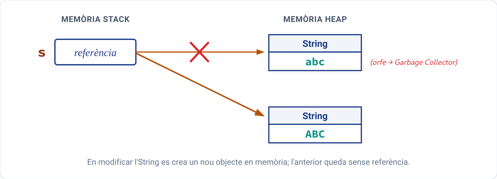
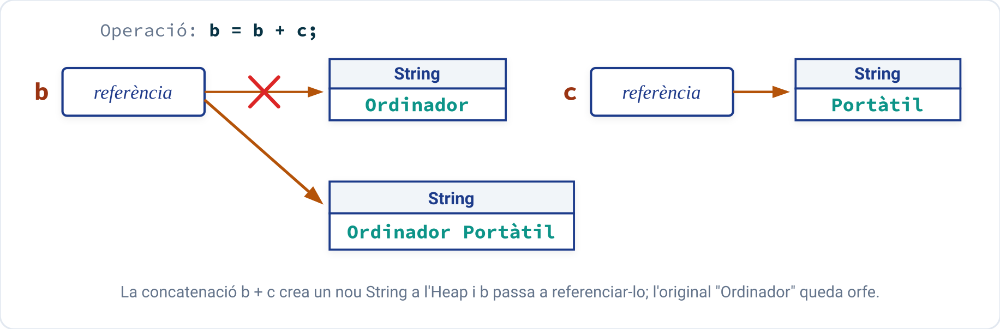

# La classe String

En Java, el tractament de text es realitza principalment a través de la classe **`java.lang.String`**. A diferència d'altres llenguatges on les cadenes són simples vectors de caràcters acabats en nul, en Java un `String` és un **objecte d'una classe de ple dret** que encapsula una seqüència de caràcters i proporciona un ampli ventall de mètodes per a operar sobre ella.

Tots els literals escrits entre cometes dobles (per exemple, `"Hola Món"`) són instàncies automàtiques de la classe `String`.

---

## 1. Immutabilitat dels objectes `String`

Una característica fonamental i distintiva dels objectes `String` en Java és que són **immutables**:

!!! important "Concepte d'immutabilitat"
    Una vegada que un objecte `String` ha sigut creat a la memòria Heap, **el seu contingut intern mai no es pot modificar**. Qualsevol mètode o operació que aparentment modifique una cadena (com `toUpperCase()`, `replace()` o la concatenació amb `+`) el que fa en realitat és **crear i retornar un objecte `String` completament nou** amb les modificacions, deixant la cadena original intacta.

Observem el següent exemple:

```java
String s = "abc";
s = s.toUpperCase();
```

1. Inicialment es crea a l'Heap l'objecte amb el text `"abc"` i la variable `s` l'apunta.
2. En cridar a `toUpperCase()`, Java crea un **segon objecte** independent amb el text `"ABC"`.
3. L'operador d'assignació `=` fa que la referència `s` passe a apuntar al nou objecte.
4. L'objecte inicial `"abc"` queda orfe en memòria i serà eliminat automàticament pel **Recol·lector de Fem** (*Garbage Collector*).

{ style="display: block; margin: 1.5em auto; max-width: 650px; width: 100%; border-radius: 4px;" }

---

## 2. Creació d'objectes `String`

Podem crear cadenes principalment de dues formes bàsiques:

### 2.1 Literals entre cometes dobles

És la forma directa i més habitual. Java utilitza una zona especial de memòria anomenada **String Constant Pool** per a optimitzar l'ús de la memòria:

```java
String s1 = "Petrer";
String s2 = "Petrer"; // Reutilitza la mateixa instància de memòria del Pool
```

### 2.2 Operador de concatenació `+`

Permet unir dues o més cadenes, o combinar cadenes amb qualsevol altre tipus de dada (`int`, `double`, `boolean`):

```java
String nom = "Laura";
int edat = 22;
String presentacio = "Hola, em dic " + nom + " i tinc " + edat + " anys.";
```

Com que els objectes `String` són immutables, en concatenar cadenes es crea sempre un nou objecte a l'Heap:

```java
String b = "Ordinador";
String c = " Portàtil";

b = b + c; // Crea un nou String ("Ordinador Portàtil") i li assigna la seua adreça a b
```

{ style="display: block; margin: 1.5em auto; max-width: 750px; width: 100%; border-radius: 4px;" }

---

## 3. Mètodes principals de la classe `String`

La classe `String` ofereix desenes de mètodes d'utilitat per al processament de text:

| Mètode | Valor de retorn | Descripció | Exemple (`s = "Programació Java"`) |
| :--- | :---: | :--- | :--- |
| **`length()`** | `int` | Retorna el nombre de caràcters de la cadena. | `s.length()` $\rightarrow$ `16` |
| **`charAt(int i)`** | `char` | Retorna el caràcter situat a la posició `i` (de $0$ a $n-1$). | `s.charAt(0)` $\rightarrow$ `'P'` |
| **`substring(int inici)`** | `String` | Retorna la subcadena des de la posició `inici` fins al final. | `s.substring(12)` $\rightarrow$ `"Java"` |
| **`substring(int inici, int fi)`** | `String` | Retorna la subcadena des de `inici` fins a `fi - 1`. | `s.substring(0, 4)` $\rightarrow$ `"Prog"` |
| **`indexOf(String text)`** | `int` | Retorna la posició de la primera aparició de `text` (o `-1` si no hi és). | `s.indexOf("gra")` $\rightarrow$ `3` |
| **`indexOf(String text, int desDe)`** | `int` | Cerca la primera aparició de `text` a partir de la posició indicada. | `s.indexOf("a", 6)` $\rightarrow$ `8` |
| **`lastIndexOf(String text)`** | `int` | Retorna la posició de l'última aparició de `text` (o `-1`). | `s.lastIndexOf("a")` $\rightarrow$ `15` |
| **`toUpperCase()`** | `String` | Retorna una nova cadena convertida a majúscules. | `s.toUpperCase()` $\rightarrow$ `"PROGRAMACIÓ JAVA"` |
| **`toLowerCase()`** | `String` | Retorna una nova cadena convertida a minúscules. | `s.toLowerCase()` $\rightarrow$ `"programació java"` |
| **`trim()`** | `String` | Elimina els espais en blanc dels extrems inicial i final. | `"  hola  ".trim()` $\rightarrow$ `"hola"` |
| **`strip()`** | `String` | Versió moderna (Java 11+) de `trim()` que reconeix tots els espais Unicode. | `"  test  ".strip()` $\rightarrow$ `"test"` |
| **`startsWith(String prefix)`** | `boolean` | Retorna `true` si la cadena comença pel prefix especificat. | `s.startsWith("Pro")` $\rightarrow$ `true` |
| **`endsWith(String sufix)`** | `boolean` | Retorna `true` si la cadena acaba pel sufix especificat. | `s.endsWith("va")` $\rightarrow$ `true` |
| **`contains(CharSequence seq)`** | `boolean` | Comprova si conté la subcadena en qualsevol posició. | `s.contains("rama")` $\rightarrow$ `true` |
| **`equals(Object altre)`** | `boolean` | Compara el contingut exacte de dues cadenes (distingeix majúscules). | `s.equals("Hola")` $\rightarrow$ `false` |
| **`equalsIgnoreCase(String a)`** | `boolean` | Compara dues cadenes ignorant majúscules i minúscules. | `"HOLA".equalsIgnoreCase("hola")` $\rightarrow$ `true` |
| **`compareTo(String altre)`** | `int` | Comparació lexicogràfica ($0$ si són iguals, $<0$ si és menor, $>0$ si és major). | `"arbre".compareTo("barca")` $\rightarrow$ $<0$ |
| **`compareToIgnoreCase(String a)`** | `int` | Comparació alfabètica sense distingir majúscules/minúscules. | `"A".compareToIgnoreCase("a")` $\rightarrow$ `0` |
| **`replace(char vell, char nou)`** | `String` | Substitueix totes les aparicions d'un caràcter per un altre. | `"casa".replace('a', 'o')` $\rightarrow$ `"coso"` |
| **`split(String regex)`** | `String[]` | Divideix la cadena en un array de subcadenes segons un separador. | `"1,2,3".split(",")` $\rightarrow$ `{"1","2","3"}` |
| **`String.valueOf(tipus v)`** | `String` | Mètode estàtic que converteix qualsevol dada primitiva a cadena. | `String.valueOf(125)` $\rightarrow$ `"125"` |

---

## 4. Comparació de cadenes: `equals()` vs `==`

Un dels errors més comuns en aprendre Java és utilitzar l'operador d'igualtat relacional `==` per a comparar cadenes:

!!! danger "Molt important: Mai compares cadenes amb `==`"
    * L'operador **`==`** compara si dues referències apunten a la **mateixa adreça de memòria física**, no el seu contingut de text.
    * El mètode **`equals()`** compara el **contingut caràcter a caràcter** dels dos textos.

```java
IO.print("Introdueix una paraula: ");
String s1 = IO.readln(); // Imaginem que l'usuari escriu "hola" per teclat
String s2 = "hola";      // Literal definit en el programa

// ERROR FREQÜENT: Compara si apunten a la mateixa adreça de memòria
if (s1 == s2) {
    IO.println("Són idèntics en memòria"); // NO s'executarà! Són dos objectes diferents
}

// FORMA CORRECTA: Compara el text caràcter a caràcter
if (s1.equals(s2)) {
    IO.println("Tenen el mateix contingut de text!"); // SÍ s'executarà
}
```

Com que la cadena `s1` s'ha creat dinàmicament en memòria en temps d'execució en llegir del teclat, es troba en una ubicació de memòria diferent del literal `s2`. Per tant, `s1 == s2` avalua a `false`. En canvi, el mètode `s1.equals(s2)` comprova que ambdues cadenes contenen exactament la mateixa seqüència de caràcters (`'h'`, `'o'`, `'l'`, `'a'`), avaluant a `true`.

---

## 5. Exemples pràctics resolts

### Exemple 1: Processament de noms i extracció d'inicials

Llegeix el nom complet d'un usuari amb cognoms (per exemple, `"  garcia pérez, joan  "`), el neteja d'espais residuals, el divideix en paraules i genera les inicials en majúscules.

??? example "Solució en Java"
    ```java
    /*
     * Programa que processa una cadena de text, neteja espais amb trim(),
     * divideix paraules amb split() i extreu les inicials en majúscules.
     */
    void main() {
        IO.print("Introdueix el teu nom complet (Nom Cognom1 Cognom2): ");
        String linia = IO.readln().trim();

        // Dividim la cadena per un o més espais en blanc
        String[] paraules = linia.split(" ");
        String inicials = "";

        IO.println("\nParaules detectades:");
        for (String p : paraules) {
            if (!p.isEmpty()) {
                IO.println("- " + p);
                // Afegim la primera lletra en majúscula
                inicials += p.substring(0, 1).toUpperCase() + ".";
            }
        }

        IO.println("\nInicials generades: " + inicials);
    }
    ```

---

### Exemple 2: Comprovació de palíndroms

Un palíndrom és una paraula que es llegeix exactament igual d'esquerra a dreta que de dreta a esquerra (per exemple: `"radar"`, `"annna"`, `"reconèixer"`). El programa comprova si una paraula introduïda per teclat compleix aquesta condició.

??? example "Solució en Java"
    ```java
    /*
     * Programa que comprova si una paraula és un palíndrom
     * comparant els caràcters simètrics des dels extrems.
     */
    void main() {
        IO.print("Introdueix una paraula per a comprovar si és palíndrom: ");
        String paraula = IO.readln().trim().toLowerCase();

        boolean esPalindrom = true;
        int i = 0;
        int j = paraula.length() - 1;

        while (i < j && esPalindrom) {
            if (paraula.charAt(i) != paraula.charAt(j)) {
                esPalindrom = false;
            }
            i++;
            j--;
        }

        if (esPalindrom && !paraula.isEmpty()) {
            IO.println("La paraula \"" + paraula + "\" ÉS un palíndrom!");
        } else {
            IO.println("La paraula \"" + paraula + "\" NO és un palíndrom.");
        }
    }
    ```
