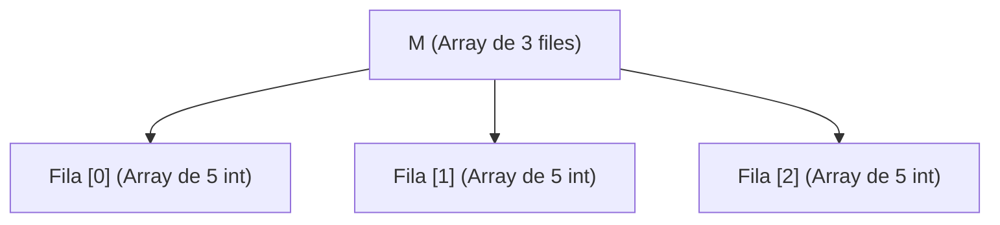

# Matrius en Java (Arrays multidimensionals)

En moltes situacions del món real, les dades s'organitzen de manera natural en forma de taules amb **files i columnes** (com ara fulls de càlcul, taulells d'escacs o imatges pixelades). En programació, aquestes estructures s'anomenen **matrius** o **arrays bidimensionals**.

---

## 1. Concepte de matriu

La dimensió d'un array ve determinada pel **nombre d'índexs necessaris per a accedir a cadascun dels seus elements**:

* Un vector és **unidimensional** perquè només requereix un índex: `vector[i]`.
* Una matriu és **bidimensional** perquè requereix dos índexs: `matriu[fila][columna]`.
  * El **primer índex** indica la **fila** (eix vertical, de $0$ a $files - 1$).
  * El **segon índex** indica la **columna** (eix horitzontal, de $0$ a $columnes - 1$).

Visualment podem representar una matriu $M$ de 3 files i 5 columnes de la manera següent:

| Índex de Fila | Columna `[0]` | Columna `[1]` | Columna `[2]` | Columna `[3]` | Columna `[4]` |
| :---: | :---: | :---: | :---: | :---: | :---: |
| **Fila `[0]`** | 1 | 2 | 3 | 4 | 5 |
| **Fila `[1]`** | 2 | 4 | 6 | **8** | 10 |
| **Fila `[2]`** | 3 | 6 | 9 | 12 | 15 |

En aquesta taula, l'element `M[1][3]` correspon a la fila 1 i la columna 3, el valor del qual és **`8`**.

### 1.1 Les matrius com a "arrays d'arrays"

En Java **no existeixen les matrius bidimensionals pures** com un bloc rígid de memòria 2D. En realitat, una matriu és un **array de referències on cadascuna apunta a un altre array independent**:



D'aquesta estructura interna es deriven dues propietats clau:

* **`M.length`**: Retorna el nombre total de **files** (en l'exemple anterior, `3`).
* **`M[i].length`**: Retorna el nombre de **columnes** que té la fila concreta `i` (en l'exemple anterior, `5`).

---

## 2. Creació i instanciació de matrius

Per a declarar i instanciar una matriu rectangular indiquem el tipus seguit de dos parells de corxets `[][]`:

```java
tipus[][] nomMatriu = new tipus[files][columnes];
```

Exemples:

```java
int[][] vendes = new int[4][6];       // Matriu de 4 files i 6 columnes d'enters
double[][] temperatures = new double[3][4]; // 3 files i 4 columnes de reals
```

### 2.1 Matrius irregulars (*Ragged Arrays*)

Com que cada fila és un array independent, Java permet crear **matrius irregulars o esglaonades**, on cada fila té una quantitat diferent de columnes.

Per a crear una matriu irregular, només s'indica obligatòriament el nombre de files en la instanciació inicial:

```java
// Creem una matriu de 3 files, deixant les columnes sense definir
int[][] m = new int[3][];

// Instanciem cada fila amb una grandària diferent
m[0] = new int[3]; // Fila 0: 3 columnes
m[1] = new int[5]; // Fila 1: 5 columnes
m[2] = new int[2]; // Fila 2: 2 columnes
```

---

## 3. Inicialització de matrius

### 3.1 Inicialització per defecte

Quan una matriu s'instancia amb `new`, tots els seus elements prenen automàticament el valor per defecte del seu tipus de dada: `0` per a enters, `0.0` per a reals, `false` per a booleans i `null` per a cadenes o referències.

### 3.2 Inicialització explícita (literals entre claus niades)

Podem declarar i inicialitzar una matriu assignant-li directament una llista de files entre claus, on cada fila és al seu torn una llista d'elements entre claus:

```java
int[][] numeros = {
    {6, 7, 5},
    {3, 8, 4},
    {1, 0, 2},
    {9, 5, 2}
}; // Matriu rectangular de 4 files i 3 columnes
```

Aquest mateix format permet declarar de forma elegant **matrius irregulars**:

```java
int[][] irregular = {
    {6, 7, 5, 0, 4}, // 5 columnes
    {3, 8, 4},       // 3 columnes
    {1, 0, 2, 7},    // 4 columnes
    {9, 5}           // 2 columnes
};
```

---

## 4. Recorregut d'una matriu

Per a recórrer una estructura bidimensional s'utilitzen habitualment **dos bucles `for` niats**:

* El **bucle exterior** (índex `i`) recorre cadascuna de les files.
* El **bucle interior** (índex `j`) recorre cadascuna de les columnes de la fila actual.

```java
int[][] a = {
    {1, 2, 3},
    {4, 5, 6}
};

// Recorregut clàssic garantint compatibilitat amb matrius irregulars
for (int i = 0; i < a.length; i++) { // a.length = nombre de files
    for (int j = 0; j < a[i].length; j++) { // a[i].length = columnes de la fila i
        IO.print(a[i][j] + "\t");
    }
    IO.println(); // Salt de línia al final de cada fila
}
```

!!! tip "Recorregut de només lectura amb bucle `for-each` niat"
    Quan no necessitem modificar els valors ni emprar les coordenades $(i, j)$, podem utilitzar el bucle `for-each` niat:
    ```java
    for (int[] fila : a) {
        for (int valor : fila) {
            IO.print(valor + " ");
        }
        IO.println();
    }
    ```

---

## 5. Exemples pràctics resolts

### Exemple 1: Cerca del valor màxim i mínim d'una matriu

Llegeix les dades d'una matriu de $5$ files i $4$ columnes, mostra la taula per pantalla i determina quin és l'element de major valor i quin el de menor, indicant les seues coordenades exactes (fila i columna).

??? example "Solució en Java"
    ```java
    /*
     * Programa que cerca el valor màxim i mínim d'una matriu
     * guardant les posicions (fila i columna) de cadascun.
     */
    void main() {
        final int FILAS = 5;
        final int COLUMNES = 4;
        int[][] a = new int[FILAS][COLUMNES];

        IO.println("Introducció d'elements de la matriu (" + FILAS + "x" + COLUMNES + "):");
        for (int i = 0; i < FILAS; i++) {
            for (int j = 0; j < COLUMNES; j++) {
                IO.print("A[" + i + "][" + j + "] = ");
                a[i][j] = Integer.parseInt(IO.readln());
            }
        }

        // Mostrem la matriu en format tabular
        IO.println("\nValors de la matriu:");
        for (int i = 0; i < a.length; i++) {
            for (int j = 0; j < a[i].length; j++) {
                IO.print(a[i][j] + "\t");
            }
            IO.println();
        }

        // Inicialitzem el màxim i mínim amb el primer element
        int major = a[0][0];
        int menor = a[0][0];
        int filaMajor = 0, colMajor = 0;
        int filaMenor = 0, colMenor = 0;

        for (int i = 0; i < a.length; i++) {
            for (int j = 0; j < a[i].length; j++) {
                if (a[i][j] > major) {
                    major = a[i][j];
                    filaMajor = i;
                    colMajor = j;
                }
                if (a[i][j] < menor) {
                    menor = a[i][j];
                    filaMenor = i;
                    colMenor = j;
                }
            }
        }

        IO.println("\nElement major: " + major + " -> Fila: " + filaMajor + ", Columna: " + colMajor);
        IO.println("Element menor: " + menor + " -> Fila: " + filaMenor + ", Columna: " + colMenor);
    }
    ```

---

### Exemple 2: Suma de dues matrius $3 \times 3$

Llegeix dues matrius $A$ i $B$ de grandària $3 \times 3$ de nombres enters, calcula la seua matriu suma $S$ (on $S[i][j] = A[i][j] + B[i][j]$) i mostra el resultat per pantalla.

??? example "Solució en Java"
    ```java
    /*
     * Programa que realitza la suma component a component de dues matrius 3x3.
     */
    void main() {
        final int MIDA = 3;
        int[][] a = new int[MIDA][MIDA];
        int[][] b = new int[MIDA][MIDA];
        int[][] suma = new int[MIDA][MIDA];

        IO.println("--- Lectura Matriu A ---");
        for (int i = 0; i < MIDA; i++) {
            for (int j = 0; j < MIDA; j++) {
                IO.print("A[" + i + "][" + j + "]: ");
                a[i][j] = Integer.parseInt(IO.readln());
            }
        }

        IO.println("\n--- Lectura Matriu B ---");
        for (int i = 0; i < MIDA; i++) {
            for (int j = 0; j < MIDA; j++) {
                IO.print("B[" + i + "][" + j + "]: ");
                b[i][j] = Integer.parseInt(IO.readln());
            }
        }

        // Càlcul de la suma element a element
        for (int i = 0; i < MIDA; i++) {
            for (int j = 0; j < MIDA; j++) {
                suma[i][j] = a[i][j] + b[i][j];
            }
        }

        IO.println("\n--- Matriu Resultant (A + B) ---");
        for (int i = 0; i < MIDA; i++) {
            for (int j = 0; j < MIDA; j++) {
                IO.print(suma[i][j] + "\t");
            }
            IO.println();
        }
    }
    ```

---

### Exemple 3: Intercanvi de dues files d'una matriu

Donada una matriu $4 \times 4$, sol·licita a l'usuari dos índexs de fila $i$ i $j$ i intercanvia tots els valors de la fila $i$ pels de la fila $j$.

??? example "Solució en Java"
    ```java
    /*
     * Programa que intercanvia dues files d'una matriu 4x4.
     */
    void main() {
        int[][] matriu = {
            {3,  5, -1, 6},
            {2,  6,  8, 2},
            {12, 4,  1, 1},
            {1,  6,  4, 2}
        };

        IO.println("Matriu original:");
        imprimirMatriu(matriu);

        IO.print("\nIndica la primera fila a intercanviar (0-3): ");
        int fila1 = Integer.parseInt(IO.readln());

        IO.print("Indica la segona fila a intercanviar (0-3): ");
        int fila2 = Integer.parseInt(IO.readln());

        // Comprovem que els índexs siguen vàlids
        if (fila1 >= 0 && fila1 < matriu.length && fila2 >= 0 && fila2 < matriu.length) {
            // Intercanvi element a element de les columnes
            for (int k = 0; k < matriu[fila1].length; k++) {
                int aux = matriu[fila1][k];
                matriu[fila1][k] = matriu[fila2][k];
                matriu[fila2][k] = aux;
            }

            IO.println("\nMatriu després d'intercanviar la fila " + fila1 + " amb la fila " + fila2 + ":");
            imprimirMatriu(matriu);
        } else {
            IO.println("Índexs de fila no vàlids.");
        }
    }

    void imprimirMatriu(int[][] m) {
        for (int i = 0; i < m.length; i++) {
            for (int j = 0; j < m[i].length; j++) {
                IO.print(m[i][j] + "\t");
            }
            IO.println();
        }
    }
    ```
